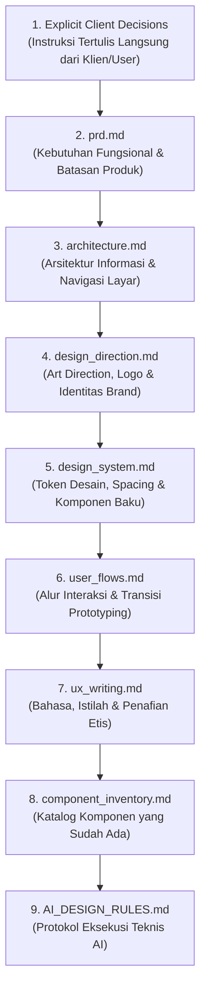

# MASTER DOCUMENTATION INDEX & HIGH-FIDELITY DESIGN FOUNDATION
## TEMAN SEBAYA — RUANG KONSELING INKLUSIF REMAJA
### Pusat Dokumentasi Desain Produk, Panduan Sistem Antarmuka & Petunjuk Kerja AI Design Agent

> **Fase Proyek**: High-Fidelity UI Design & Productization  
> **Status Dokumen**: 🟢 **OFFICIAL MASTER REPOSITORY**  
> **Lokasi Repositori**: `markdown/prototype/`  
> **Platform Acuan**: Mobile Android-First (360 × 800 px) & iOS  
> **File Kanvas Utama**: [`teman-sebaya.figcraft`](file:///c:/Users/Fhazar/Fhazar_Workspace/02_PROJECTS/teman-sebaya/teman-sebaya.figcraft)  
> **Terakhir Diperbarui**: 9 November 2026

---

## 1. STRUKTUR FOLDER DOKUMENTASI PROYEK

Folder dokumentasi proyek Teman Sebaya dipisahkan secara tegas berdasarkan fase kedewasaan desain (*design maturity phase*):

```
markdown/
├── prototype/                ← 🟢 FASE SAAT INI: HIGH-FIDELITY UI DESIGN & PRODUCTIZATION
│   ├── README.md             → Master index, arsitektur dokumen, dan panduan navigasi repositori.
│   ├── prd.md                → Product Requirements Document (kebutuhan produk, cakupan, user stories).
│   ├── architecture.md       → Arsitektur produk, arsitektur informasi (IA), hierarki layar, data entities.
│   ├── design_direction.md   → Pedoman art direction, analisis referensi, eksplorasi palet warna & tipografi.
│   ├── design_system.md      → Single source of truth token warna, tipografi, grid, komponen & Auto Layout.
│   ├── user_flows.md         → Seluruh diagram alur pengguna end-to-end, interaksi, dan transisi layar.
│   ├── ux_writing.md         → Panduan suara brand, nada bicara, kamus istilah baku, dan penafian etis AI.
│   ├── component_inventory.md→ Katalog komponen terstandarisasi, struktur Auto Layout, dan registri layar.
│   └── AI_DESIGN_RULES.md    → 10 Aturan kerja mutlak dan checklist QA untuk AI Design Agent.
│
└── wireframe/                ← ⚪ FASE SEBELUMNYA: LOW-FIDELITY WIREFRAME (ARSIP KEBENARAN STRUKTURAL)
    ├── prompt-wireframe-teman-sebaya.md → Dokumen sumber asli Canva & wireframe requirements baseline.
    ├── design_system.md                 → Token awal wireframe skala abu-abu (grayscale baseline).
    └── REFERENCE_DESIGN_GUIDELINES.md   → Panduan awal operasional adaptasi referensi visual wireframe.
```

> [!IMPORTANT]
> **Pemisahan Peran**: Folder `markdown/wireframe/` adalah dokumentasi struktural dan persyaratan dasar yang **TIDAK BOLEH DITIMPA ATAU DIUBAH**. Seluruh pengembangan antarmuka visual kaya warna, tipografi modern, dan komponen interaktif final **sepenuhnya dikelola di folder `markdown/prototype/`**.

---

## 2. INDEKS & PERAN SETIAP DOKUMEN HIGH-FIDELITY

| Nama File | Dokumen ID | Tujuan & Cakupan Pembahasan |
| :--- | :---: | :--- |
| [`prd.md`](file:///c:/Users/Fhazar/Fhazar_Workspace/02_PROJECTS/teman-sebaya/markdown/prototype/prd.md) | `PRD-TS-001` | **Product Requirements Document**: Mendefinisikan visi produk, profil remaja sasaran, cakupan in-scope vs out-of-scope, 8 modul fungsional, user stories, acceptance criteria, dan batasan etika. |
| [`architecture.md`](file:///c:/Users/Fhazar/Fhazar_Workspace/02_PROJECTS/teman-sebaya/markdown/prototype/architecture.md) | `ARCH-TS-002` | **Information & Screen Architecture**: Struktur navigasi 3 tingkat, inventaris lengkap 46 layar (29 layar Page 1 + 17 layar Page 2 Mood Flow), hubungan data entitas konseptual, dan matriks state sistem. |
| [`design_system.md`](file:///c:/Users/Fhazar/Fhazar_Workspace/02_PROJECTS/teman-sebaya/markdown/prototype/design_system.md) | `DS-TS-003` | **Design System Single Source of Truth**: Token resmi warna brand (Azure Blue, Fresh Mint, Warm Peach), skala tipografi sans-serif, spacing kelipatan 4/8, radius sudut, elevasi, vektor Lucide SVG, dan spesifikasi komponen. |
| [`design_direction.md`](file:///c:/Users/Fhazar/Fhazar_Workspace/02_PROJECTS/teman-sebaya/markdown/prototype/design_direction.md) | `DIR-TS-004` | **Art Direction & Reference Analysis**: Dekonstruksi visual logo resmi Teman Sebaya, analisis screenshot referensi wellness/mental health, evaluasi 3 kandidat palet warna, dan filosofi kartu permukaan terang. |
| [`user_flows.md`](file:///c:/Users/Fhazar/Fhazar_Workspace/02_PROJECTS/teman-sebaya/markdown/prototype/user_flows.md) | `FLOW-TS-005` | **End-to-End User Journeys**: Diagram alur Mermaid lengkap mulai dari Splash, Onboarding, Login/Tamu, Mood Check-in 6 emosi mendalam, Beranda, Teman Cerita, Teman Belajar, Teman Tumbuh, Komunitas, hingga Teman Akses. |
| [`ux_writing.md`](file:///c:/Users/Fhazar/Fhazar_Workspace/02_PROJECTS/teman-sebaya/markdown/prototype/ux_writing.md) | `UXW-TS-006` | **UX Writing & Ethical Copywriting**: Panduan nada bicara kawan sebaya, kamus istilah terlarang vs baku, kalimat penafian etis AI wajib, teks tombol aksi, pesan error bersahabat, dan mitigasi krisis darurat. |
| [`component_inventory.md`](file:///c:/Users/Fhazar/Fhazar_Workspace/02_PROJECTS/teman-sebaya/markdown/prototype/component_inventory.md) | `INV-TS-007` | **Master Component Catalog**: Katalog 8 kategori komponen UI terstandarisasi, struktur Auto Layout FigCraft, properti dimensi, state interaksi, dan matriks penggunaan komponen di seluruh 46 layar aplikasi. |
| [`AI_DESIGN_RULES.md`](file:///c:/Users/Fhazar/Fhazar_Workspace/02_PROJECTS/teman-sebaya/markdown/prototype/AI_DESIGN_RULES.md) | `RULE-TS-008` | **Mandatory Operational Directives for AI**: Peraturan mutlak bagi AI Agent untuk tidak mengulang tampilan grayscale wireframe, menegakkan text wrapping anti-overflow, isolasi cakupan revisi, dan 12 checklist QA. |

---

## 3. HIERARKI DOKUMENTASI & PENGAMBILAN KEPUTUSAN

Jika di masa mendatang timbul perbedaan interpretasi atau benturan informasi antar-dokumen, gunakan hierarki prioritas berikut:



> **Aturan Resolusi Konflik**: Keputusan klien yang bersifat eksplisit selalu menempati urutan pertama. Jika ditemukan konflik yang belum memiliki dasar keputusan, **AI dilarang mengambil keputusan sepihak secara diam-diam**. AI wajib mendokumentasikan opsi pertimbangan dan menandai status sebagai `[UNRESOLVED]` hingga mendapat persetujuan klien.

---

## 4. CURRENT DESIGN STATUS & CLASSIFICATION SUMMARY

Seluruh elemen dalam dokumentasi diklasifikasikan menggunakan 5 penanda status baku:

- 🟢 **`[APPROVED]` (Disetujui)**:
  - Konsep Super App Ruang Konseling Inklusif Remaja.
  - Identitas Biru Logo Teman Sebaya.
  - Keputusan seluruh teks utama wajib menggunakan font Sans-Serif modern.
  - Fitur Akses Masuk Cepat / Mode Tamu (*Guest Mode*).
  - Alur Mood Check-in 6 Kategori Emosi Utama + 50 Perasaan Spesifik.
  - Kehadiran Tombol Darurat Krisis Terpadu 119 Ext 8 di modul sensitif.
- 🟡 **`[EXISTING / BASELINE]`**:
  - 29 Layar wireframe di Page 1 file `teman-sebaya.figcraft`.
  - 17 Layar Mood Check-in Flow di Page 2 file `teman-sebaya.figcraft`.
  - Struktur Auto Layout native dan registri ikon Lucide SVG.
- 🔵 **`[PROPOSED]` (Diajukan untuk Fase High-Fidelity)**:
  - Arah visual *"Modern Friendly Digital Companion"*.
  - Palet warna resmi **Kandidat 1: Azure Sky (`#3B82F6`), Fresh Mint (`#10B981`), Warm Peach (`#F97316`)**.
  - Font pairing resmi: `Plus Jakarta Sans` (Primary UI) + `Outfit` (Display Heading).
  - Tampilan kartu putih bersih di atas latar canvas terang (`#F8FAFC`).
- 🔴 **`[DEPRECATED]` (Diarsipkan / Ditinggalkan)**:
  - Tampilan visual grayscale kusam pada seluruh layar (hanya digunakan untuk fase wireframe lampau).
  - Istilah artefak pengembangan: *demo, simulasi, dummy data, testing, placeholder*.
- ⚪ **`[UNRESOLVED]` (Menunggu Keputusan Lanjutan Klien)**:
  - Integrasi nomor kontak WhatsApp konselor sebaya PIK-R kabupaten Karawang dan Jawa Barat.
  - Integrasi database riil untuk penyimpanan jurnal emosi lintas perangkat.

