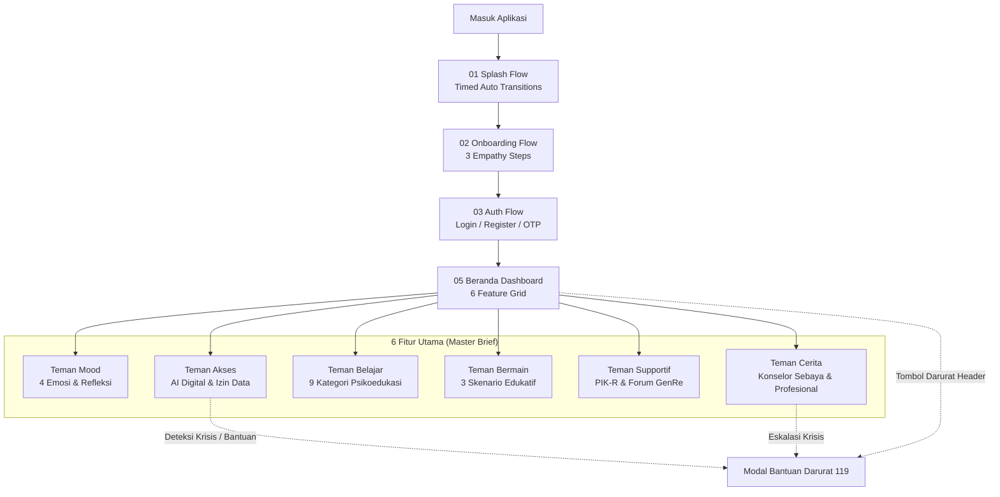

# PRODUCT & INFORMATION ARCHITECTURE
## TEMAN SEBAYA — RUANG KONSELING INKLUSIF REMAJA
### Arsitektur Informasi, Hierarki Layar, Peta Prototipe & Relasi Data

> **Dokumen ID**: `ARCH-TS-002-REV2`  
> **Status Dokumen**: 🟢 **APPROVED / MASTER IMPLEMENTED**  
> **Platform Target**: Mobile Android Standard (412 × 917 px)  
> **Lokasi File**: `markdown/prototype/architecture.md`  
> **Design Canvas**: Single Page Rule — Page `Hi-fi Design` (Page ID `1821`) pada `teman-sebaya.figcraft`  
> **Total Layar**: 32 Mobile Screens (8 Rows × 4 Columns Grid)  
> **Total Prototype Interactions**: 116 Active Prototype Links  

---

## 1. PRODUCT ARCHITECTURE OVERVIEW

Arsitektur produk Teman Sebaya dibangun di atas konsep **Tiga Lapisan Perlindungan & Pendampingan Remaja (Three Layers of Youth Digital Care)** yang diselaraskan dengan dokumen spesifikasi master (*BRIEF TEMAN SEBAYA*):

1. **Lapisan Regulasi Emosi & Refleksi Mandiri (Self-Discovery Layer)**:
   - **Teman Mood**: Pelacakan 4 emosi primer (Bahagia, Sedih, Marah, Biasa Saja) dan 7 konteks.
   - **Teman Belajar**: 9 kategori psikoedukasi terstruktur dan video edukasi.
   - **Teman Bermain**: 3 game reflektif (Butterfly Effect, Name That Feeling, Digital Dilemma) tanpa sistem penalti atau peringkat mental.
2. **Lapisan Ruang Berbagi & Pendampingan Manusia (Peer & Professional Counseling Layer)**:
   - **Teman Cerita**: Layanan pendampingan manusia berjadwal dengan Konselor Sebaya (60 min) dan Psikolog Profesional (30 min).
   - **Teman Supportif**: Wadah komunitas positif remaja (PIK-R dan Forum GenRe Karawang).
3. **Lapisan Akses Pendamping Digital & Tanggap Krisis (Digital AI & Crisis Safety Layer)**:
   - **Teman Akses**: Asisten obrolan AI dengan penafian etis transparan, izin data mood opsional, dan tombol darurat SEJIWA 119 Ext 8.

---

## 2. DETAILED SCREEN HIERARCHY & NODE REGISTRY (32 SCREENS)

| Baris / Alur | Kolom | Nama Layar di Canvas | Node ID | Posisi (X, Y) | Fungsi Utama |
| :--- | :---: | :--- | :---: | :---: | :--- |
| **Row 1: Splash** | 1 | `Splash Screen` | 4404 | 6800, 80 | Initial app launch |
| | 2 | `Splash Animation Initial` | 4420 | 7292, 80 | Micro-animation step 1 |
| | 3 | `Splash Animation Reveal` | 4435 | 7784, 80 | Micro-animation step 2 |
| | 4 | `Splash Animation Settled` | 4450 | 8276, 80 | Micro-animation step 3 |
| **Row 2: Onboarding** | 1 | `Onboarding 1` | 4467 | 6800, 1180 | Pengenalan ruang aman |
| | 2 | `Onboarding 2` | 4500 | 7292, 1180 | Jaminan privasi dan tanpa stigma |
| | 3 | `Onboarding 3` | 4541 | 7784, 1180 | Kebebasan eksplorasi remaja |
| | 4 | `Onboarding Complete` | 4575 | 8276, 1180 | Pintu masuk autentikasi (Zero Guest) |
| **Row 3: Authentication** | 1 | `Login` | 4606 | 6800, 2280 | Masuk akun terdaftar |
| | 2 | `Register` | 4650 | 7292, 2280 | Pendaftaran akun baru |
| | 3 | `Registration Verification` | 4699 | 7784, 2280 | Input 4-digit OTP code |
| | 4 | `Registration Success` | 4728 | 8276, 2280 | Ucapan selamat bergabung |
| **Row 4: Password Recovery** | 1 | `Forgot Password` | 4749 | 6800, 3380 | Permintaan reset via email |
| | 2 | `Verify Code` | 4804 | 7292, 3380 | OTP pemulihan kata sandi |
| | 3 | `Create New Password` | 4836 | 7784, 3380 | Form sandi baru & meter indikator |
| | 4 | `Password Reset Success` | 4870 | 8276, 3380 | Konfirmasi berhasil perbarui sandi |
| **Row 5: Beranda & Mood** | 1 | `Beranda - Default` | 5243 | 6800, 4480 | Dashboard utama & quick logger |
| | 2 | `Beranda - Mood Tercatat` | 5322 | 7292, 4480 | Dashboard status mood tersimpan |
| | 3 | `Mood Selection & Detail` | 5391 | 7784, 4480 | Refleksi 6 emosi & jurnal pribadi |
| | 4 | `Mood Statistics` | 5442 | 8276, 4480 | Grafik distribusi emosi 7 hari |
| **Row 6: Teman Cerita** | 1 | `Teman Cerita - Default` | 5502 | 6800, 5560 | Pilihan topik obrolan awal |
| | 2 | `Teman Cerita - Percakapan Aktif` | 5561 | 7292, 5560 | Dialog dua arah empati AI |
| | 3 | `Teman Cerita - Panduan Relaksasi` | 5592 | 7784, 5560 | Latihan pernapasan 4-7-8 |
| | 4 | `Dialog Bantuan Darurat` | 5617 | 8276, 5560 | Modal darurat 119 Ext 8 & 112 |
| **Row 7: Belajar & Tumbuh** | 1 | `Teman Belajar - Default` | 5633 | 6800, 6640 | Direktori artikel psikoedukasi |
| | 2 | `Teman Belajar - Kuis Evaluasi` | 5685 | 7292, 6640 | Hasil evaluasi kuis 3 soal |
| | 3 | `Teman Tumbuh - Default` | 5711 | 7784, 6640 | Eksplorasi minat & kebiasaan |
| | 4 | `Teman Tumbuh - Tantangan Positif` | 5764 | 8276, 6640 | Pelacak progres tantangan 3 hari |
| **Row 8: Komunitas, Akses & Profil** | 1 | `Teman Komunitas` | 5802 | 6800, 7720 | Direktori komunitas binaan PIK-R |
| | 2 | `Teman Akses - Jalur Bantuan` | 5883 | 7292, 7720 | Kontak rujukan resmi (BPJS, LSM) |
| | 3 | `Profil Pengguna` | 5967 | 7784, 7720 | Identitas, privasi & pengaturan |
| | 4 | `Dialog Logout` | 6044 | 8276, 7720 | Konfirmasi keamanan keluar sesi |

---

## 3. PROTOTYPE INTERACTION GRAPH ARCHITECTURE (116 LINKS)

### 3.1. Kebijakan Transisi Prototipe
- **Navigasi Layar**: Menggunakan transisi `dissolve` dengan durasi 200ms hingga 250ms dan kurva *easeOut*.
- **Perpindahan Tab (Bottom Nav Bar)**: Menggunakan transisi `instant` (0ms) untuk meniru performa *native app tab switching* yang responsif.
- **Batasan Smart Animate**: Dilarang keras menggunakan *Smart Animate* untuk navigasi antar layar penuh; hanya dialokasikan untuk mikro-interaksi state lokal pada component set.

### 3.2. Rute Navigasi Primer
1. **Entry Experience**:
   - `Splash Screen` (4404) $\rightarrow$ `Onboarding 1` (4467) via timed delay 900ms.
   - `Onboarding 1` $\rightarrow$ `Onboarding 2` $\rightarrow$ `Onboarding 3` $\rightarrow$ `Onboarding Complete`.
   - `Onboarding Complete` (4575) $\rightarrow$ "Masuk" ke `Login` (4606), "Daftar" ke `Register` (4650).
2. **Autentikasi ke Beranda**:
   - `Login Masuk Button` (4644) $\rightarrow$ `Beranda - Default` (5243) (Dissolve 250ms).
   - `Registration Success Mulai Button` (4745) $\rightarrow$ `Beranda - Default` (5243) (Dissolve 250ms).
   - `Password Reset Success Masuk Button` (4887) $\rightarrow$ `Login` (4606) (Dissolve 200ms).
3. **Beranda & Mood Flow**:
   - Mood quick pills $\rightarrow$ `Beranda - Mood Tercatat` (5322).
   - "Eksplorasi Detail" link $\rightarrow$ `Mood Selection & Detail` (5391).
   - "Simpan Suasana Hati" button $\rightarrow$ `Mood Statistics` (5442).
   - "Kembali ke Beranda" button $\rightarrow$ `Beranda - Default` (5243).
4. **Teman Cerita & Emergency Escalation**:
   - Topik starter cards $\rightarrow$ `Teman Cerita - Percakapan Aktif` (5561).
   - Banner relaksasi & inline chat card $\rightarrow$ `Teman Cerita - Panduan Relaksasi` (5592).
   - Pill header "Darurat 119" $\rightarrow$ `Dialog Bantuan Darurat` (5617).
   - Tombol "Kembali ke Obrolan" $\rightarrow$ `Teman Cerita - Percakapan Aktif` (5561).
5. **Teman Belajar & Teman Tumbuh**:
   - Card "Mulai Kuis Sekarang" $\rightarrow$ `Teman Belajar - Kuis Evaluasi` (5685).
   - Card "Buka Detail Tantangan" $\rightarrow$ `Teman Tumbuh - Tantangan Positif` (5764).
6. **Profil & Logout Dialog**:
   - Avatar icon di Global Header $\rightarrow$ `Profil Pengguna` (5967).
   - Tombol "Keluar dari Akun" $\rightarrow$ `Dialog Logout` (6044).
   - Tombol "Batal, Tetap di Sini" $\rightarrow$ `Profil Pengguna` (5967).
   - Tombol "Ya, Keluar Akun" $\rightarrow$ `Login` (4606).
7. **Universal Bottom Navigation (5 Tabs)**:
   - Tab Beranda $\rightarrow$ `Beranda - Default`
   - Tab Cerita $\rightarrow$ `Teman Cerita - Default`
   - Tab Belajar $\rightarrow$ `Teman Belajar - Default`
   - Tab Tumbuh $\rightarrow$ `Teman Tumbuh - Default`
   - Tab Akses $\rightarrow$ `Teman Akses - Jalur Bantuan`
