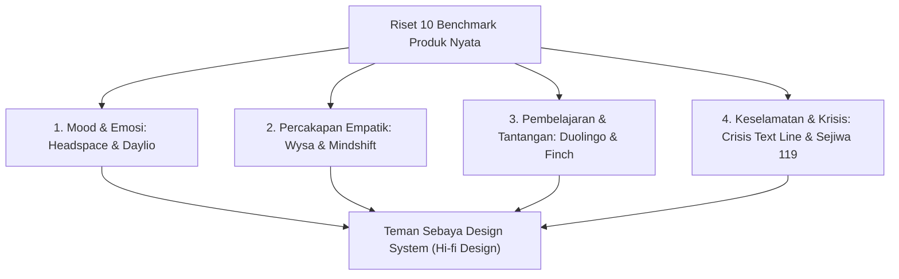

# DESIGN RESEARCH & VISUAL BENCHMARKING
## TEMAN SEBAYA — RUANG KONSELING INKLUSIF REMAJA
### Riset Pola UI/UX, Benchmark Produk Nyata & Strategi Adaptasi Desain

> **Dokumen ID**: `RES-TS-009`  
> **Status Dokumen**: 🟢 **VERIFIED / APPLIED BENCHMARK**  
> **Platform Target**: Mobile Android & iOS (412 × 917 px & 360 × 800 px)  
> **Lokasi File**: `markdown/prototype/design_research.md`  
> **Tujuan**: Menetapkan benchmark visual nyata dari 10 produk digital ternama untuk mencegah pola desain generik hasil AI.

---

## 1. EXECUTIVE RESEARCH SUMMARY

Riset ini mengkaji 10 produk digital dan studi kasus UI/UX nyata di bidang *mental wellness*, edukasi interaktif, percakapan empatik, dan intervensi krisis remaja. Teman Sebaya mengadopsi prinsip **"Modern Friendly Editorial"** yang menggabungkan kematangan antarmuka produk modern dengan kehangatan sahabat sebaya.

---

## 2. DETAIL ANALISIS 10 REFERENSI & STRATEGI ADAPTASI

### 2.1. Headspace (Mental Wellness & Mood Check-in)
- **Sumber & Tautan**: [Mobbin Headspace iOS Flows](https://mobbin.com/browse/ios/apps) & [Dribbble Headspace Concepts](https://dribbble.com/tags/headspace)
- **Kategori**: Mental wellness, Mood check-in, Journaling.
- **Visual Patterns**: Card terstruktur dengan sudut membulat lebar ($16–20\text{ px}$), ilustrasi organik ramah, palet warna pastel menenangkan, tipografi display bersahabat.
- **UX Patterns**:
  - *Progressive Disclosure*: Menampilkan satu pertanyaan emosi dalam satu waktu untuk mencegah *cognitive overload*.
  - *Actionable Loop*: Pencatatan emosi tidak berhenti pada pengisian data, melainkan langsung memberikan umpan balik reflektif atau rekomendasi konten yang relevan.
- **Strategi Adaptasi Teman Sebaya**: Diadopsi pada alur *Mood Check-in* (Page 1195 & Beranda), di mana pemilihan emosi langsung menghasilkan kutipan refleksi yang menenangkan dan ringkasan visual harian.

### 2.2. Wysa (AI Conversational Mental Health for Teens)
- **Sumber & Tautan**: [Mobbin Wysa Flows](https://mobbin.com/browse/ios/apps) & [Dribbble Wysa Case Studies](https://dribbble.com/tags/wysa)
- **Kategori**: Chat & Percakapan Empatik, Safety Escalation.
- **Visual Patterns**: Balon pesan ber-whitespace lapang, masking avatar sahabat yang ramah (bukan robot kaku), pill topik cepat (*quick-reply action chips*).
- **UX Patterns**:
  - Transparansi peran AI sejak awal percakapan (*ethical transparency*).
  - Pemicu bantuan krisis persisten (*persistent crisis help button*) yang tidak mengintimidasi namun mudah dijangkau saat darurat.
- **Strategi Adaptasi Teman Sebaya**: Diadopsi pada *Teman Cerita* dengan banner transparansi etis AI di atas percakapan, 4 pill topik cepat, dan tombol darurat 119 di header.

### 2.3. Daylio (Micro-Journaling & Mood Tracker)
- **Sumber & Tautan**: [Daylio Official App](https://daylio.net) & [Dribbble Daylio Redesigns](https://dribbble.com/tags/daylio)
- **Kategori**: Mood Tracking, Analytics Dashboard.
- **Visual Patterns**: Spektrum warna emosi intuitif (Hijau untuk tenang/bahagia, Kuning/Oranye untuk semangat/lelah, Biru/Abu untuk cemas/sedih), chart kapsul vertikal, ringkasan mingguan.
- **UX Patterns**:
  - Pencatatan 2-sentuhan cepat (*two-tap logging*): Pilih emosi dasar $\rightarrow$ Pilih detail perasaan.
- **Strategi Adaptasi Teman Sebaya**: Diadopsi pada komponen *Quick Mood Logger* di Beranda (5 pill emosi sejajar) dan visualisasi chart kapsul di layar statistik emosi.

### 2.4. Duolingo (Interactive Quiz & Habit Challenges)
- **Sumber & Tautan**: [Mobbin Duolingo Flows](https://mobbin.com/browse/ios/apps) & [Dribbble Duolingo UI](https://dribbble.com/tags/duolingo)
- **Kategori**: Educational Content, Gamified Learning, Habits.
- **Visual Patterns**: Progress bar tersegmentasi tipis, kartu kuis interaktif dengan umpan balik warna instan, lencana pencapaian ramah.
- **UX Patterns**:
  - Umpan balik kuis non-punitif (ketika salah menjawab, sistem menyemangati untuk membaca kembali tanpa label kegagalan).
  - Tantangan mikro 3 hari (*bite-sized habit streaks*).
- **Strategi Adaptasi Teman Sebaya**: Diadopsi pada *Teman Belajar* (kuis 3 pertanyaan dengan umpan balik edukatif skor 3/3 dan 0/3) serta *Teman Tumbuh* (pelacak 3 tantangan positif harian).

### 2.5. Crisis Text Line (Emergency Crisis & Support Systems)
- **Sumber & Tautan**: [Crisis Text Line Standards](https://www.crisistextline.org) & [Digital Mental Health Case Studies](https://cocowang.design)
- **Kategori**: Assistance & Emergency Crisis.
- **Visual Patterns**: Palet warna stabilitas (navy/slate tenang, aksen coral/amber untuk peringatan darurat tanpa menggunakan warna merah darah menyala yang memicu panik), tombol sentuh besar ($48\text{ px}$).
- **UX Patterns**:
  - Penegasan privasi dan kerahasiaan penuh (*"Bebas Pulsa, 24 Jam, Terjaga Kerahasiaannya"*).
  - Penyediaan latihan pernapasan grounding saat pengguna menunggu respon bantuan.
- **Strategi Adaptasi Teman Sebaya**: Diadopsi pada *Dialog Bantuan Darurat 119* dan *Panduan Relaksasi 4-7-8* di Teman Cerita dan Teman Akses.

### 2.6. Mindshift CBT (Teen Anxiety & Emotional Regulation)
- **Sumber & Tautan**: [Anxiety Canada - Mindshift CBT App](https://www.anxietycanada.com/resources/mindshift-cbt/)
- **Kategori**: Self-Help, Relaksasi Mandiri.
- **Visual Patterns**: Antarmuka bersih, kartu langkah pernapasan bertahap dengan ritme detik visual.
- **Strategi Adaptasi Teman Sebaya**: Diadopsi pada layar *Panduan Relaksasi 4-7-8* (`Tarik Napas 4d`, `Tahan 7d`, `Hembuskan 8d`).

### 2.7. Finch: Self-Care Pet (Youth Growth & Empathy)
- **Sumber & Tautan**: [Mobbin Finch App](https://mobbin.com/browse/ios/apps) & [Dribbble Self-Care Concepts](https://dribbble.com/tags/self-care)
- **Kategori**: Youth Self-Care, Emotional Reflection.
- **Visual Patterns**: Maskot ramah, teks apresiasi hangat ("Kamu hebat sudah bertahan hari ini"), interaksi reflektif mikro.
- **Strategi Adaptasi Teman Sebaya**: Diadopsi pada copywriting empati dan maskot ramah logo Teman Sebaya.

### 2.8. Calm (Spacious Audio & Meditation UX)
- **Sumber & Tautan**: [Mobbin Calm iOS Flows](https://mobbin.com/browse/ios/apps)
- **Kategori**: Spacious Layout, Audio Waves, Breathing.
- **Visual Patterns**: Whitespace lega, kartu putih di atas latar terang, bayangan sangat halus (*diffuse elevation*).
- **Strategi Adaptasi Teman Sebaya**: Menjadi rujukan utama layout *Modern Friendly Editorial* (menolak dashboard yang padat sesak).

### 2.9. Layanan Sejiwa 119 Ext 8 (Kemenkes RI)
- **Sumber & Tautan**: [Kementerian Kesehatan RI - Layanan Sejiwa 119](https://sehatnegeriku.kemkes.go.id/)
- **Kategori**: Jalur Bantuan Resmi Indonesia.
- **Informasi Faktual**: Hotline bebas pulsa resmi untuk pertolongan pertama kesehatan jiwa nasional di Indonesia.
- **Strategi Adaptasi Teman Sebaya**: Menjadi rujukan nomor telepon darurat tunggal yang sah pada aplikasi (dilarang mengarang nomor fiktif).

### 2.10. Panduan Konseling Sebaya PIK-R & Forum GenRe (BKKBN)
- **Sumber & Tautan**: [Badan Kependudukan dan Keluarga Berencana Nasional (BKKBN) - Program GenRe](https://genreindonesia.bkkbn.go.id/)
- **Kategori**: Komunitas Remaja Sebaya Resmi Indonesia.
- **Informasi Faktual**: Pusat Informasi dan Konseling Remaja (PIK-R) dan Generasi Berencana (GenRe) merupakan wadah resmi edukasi kesehatan reproduksi dan pendampingan sebaya di sekolah dan desa di Indonesia.
- **Strategi Adaptasi Teman Sebaya**: Diadopsi sebagai pilar konten modul *Teman Komunitas* dengan label edukasi yang transparan.

### 2.11. JMIR Serious Games & Situational Judgment Tests (SJT) for Youth
- **Sumber & Tautan**: [JMIR Serious Games (2023)](https://games.jmir.org/) & [Frontiers in Psychology (2022)](https://www.frontiersin.org/journals/psychology)
- **Kategori**: Interactive Psychology Games & Scenario Reflection.
- **Visual & UX Patterns**:
  - Narasi skenario kontekstual sekolah/sosial remaja tanpa jargon medis.
  - Pilihan tindakan A, B, C dengan konsekuensi psikologis reflektif seketika.
  - Pemetaan hasil berbasis arketipe karakter positif (bukan diagnosis klinis).
  - Penghapusan HUD / vitals meter berlebih agar pengguna fokus pada refleksi naratif.
- **Strategi Adaptasi Teman Sebaya**: Diterapkan pada modul *Teman Bermain* (Game Psikologi: Ekspedisi Karakter, Menembus Badai Resiliensi, dan Radar Relasi Sehat).

### 2.12. Floating Overlay Feedback & Toast Micro-interactions
- **Sumber & Tautan**: [Material Design 3 Snackbar/Toast Patterns](https://m3.material.io/components/snackbar) & [Apple Human Interface Guidelines - Temporary Feedback](https://developer.apple.com/design/human-interface-guidelines/transient-views)
- **Kategori**: Micro-interactions & Temporary Notification.
- **Visual & UX Patterns**:
  - Tampilan mengambang (*floating pill/capsule*) pada bagian atas layar dengan animasi slide-down dan fade-in.
  - Memanfaatkan posisi absolut (`position: absolute; top: 16px`) yang sepenuhnya terisolasi dari flow tata letak halaman agar tidak memicu *layout shift* atau menggeser konten utama.
  - Auto-dismiss dalam rentang waktu yang nyaman ($2.5–3.0\text{ detik}$) dengan opsi penutupan instan.
- **Strategi Adaptasi Teman Sebaya**: Diimplementasikan pada komponen `FloatingToast` yang diinjeksi via `ScreenContainer.floatingOverlay` di modul artikel dan simpan refleksi.

---

## 3. MATRIX POLA VISUAL & UX YANG DITERAPKAN DI TEMAN SEBAYA

| Modul Aplikasi | Pola Visual yang Diterapkan | Pola UX yang Diterapkan | Anti-Pattern yang Ditolak |
|:---|:---|:---|:---|
| **Splash Screen** | Logo proporsional teranimasi halus, tipografi brand "TEMAN SEBAYA", progress bar minimalis 3px. | Auto-transition mulus 2.2 detik menuju Onboarding tanpa benturan tombol skip. | ❌ Kotak latar biru acak di belakang logo; ❌ Animasi berputar kasar. |
| **Onboarding** | Step pill "Langkah X dari 3", visual badge bertema ramah (150×150), tipografi hierarkis. | Carousel 3 langkah dengan tombol Lewati dan CTA Lanjut responsif. | ❌ Kartu terpecah-pecah; ❌ Teks panjang tanpa struktur. |
| **Onboarding Complete**| Logo maskot bersih, salinan jujur & menenangkan, trust note dengan icon `ShieldCheck`. | Opsi autentikasi tegas: "Masuk ke Akun" dan "Daftar Akun Baru". | ❌ Klaim palsu ("ribuan remaja", "enkripsi mutlak"); ❌ Guest mode tanpa proteksi. |
| **Beranda** | Clean editorial layout, quick mood logger 5 pill, portal cards ber-elevation Level 1. | Pengguna dapat mencatat emosi instan tanpa berpindah halaman, navigasi 5 tab persisten. | ❌ Menjejali seluruh fitur ke dalam kartu identik bertumpuk; ❌ Gradien latar menyala. |
| **Teman Bermain (Game Hub)**| Filter kategori (Semua, Karakter, Resiliensi, Relasi), kartu modul ber-metadata durasi & skenario. | Pengguna memilih eksplorasi psikologis interaktif berbasis skenario nyata remaja. | ❌ Badge bertumpuk tak beraturan; ❌ Border warna-warni yang menimbulkan noise. |
| **Teman Bermain (Game Play)**| Header bersih dengan progress bar, fokus utama pada narasi skenario, opsi A/B/C min 48px, refleksi psikoedukasi instan. | Pemain memilih langkah keputusan, mendapatkan umpan balik ilmiah, tombol lanjut docked bawah layar. | ❌ HUD meter (stamina/XP) yang mengacaukan bacaan; ❌ Emoji acak sebagai label pilihan. |
| **Teman Bermain (Result)**| Hero title arketipe karakter, non-clinical disclaimer, spektrum dimensi Big Five, kartu Superpowers & Growth Points. | Pemain dapat menyimpan refleksi ke profil, membagikan hasil, atau terhubung ke konseling Teman Cerita. | ❌ XP palsu / sistem ranking kompetitif; ❌ Diagnosis medis pseudo-klinis. |
| **Teman Cerita** | Balon pesan asimetris (Kanan: `#2563EB`, Kiri: `#F1F5F9`), header darurat krisis merah halus. | Banner transparansi AI di awal obrolan, pill topik cepat, tombol darurat selalu terlihat. | ❌ Memberi kesan AI adalah dokter/psikolog; ❌ Ikon robot atau glitter magic. |
| **Teman Belajar** | Segmented filter pill, kartu artikel 2-3 paragraf ramah baca, floating toast notifikasi bersih. | Evaluasi hasil kuis yang suportif, bookmark artikel tanpa pergeseran layout. | ❌ Toast bar inline yang mendorong konten ke bawah; ❌ Artikel tanpa jeda baca. |
| **Teman Tumbuh** | Tab 4 pilar pertumbuhan, checklist kebiasaan 3 hari dengan progress counter visual `0/3` s.d `3/3`. | Penegasan eksplorasi minat sebagai inspirasi reflektif, bukan hasil tes psikometrik klinis formal. | ❌ Mengklaim hasil sebagai diagnosis bakat mutlak. |
| **Teman Komunitas**| Kartu profil organisasi resmi (PIK-R & GenRe), label edukasi transparansi. | Informasi wadah kegiatan positif terkurasi untuk mempertemukan remaja dengan jejaring sehat. | ❌ Fitur chat publik tanpa moderasi yang memicu cyberbullying. |
| **Teman Akses & Krisis** | Modal darurat bersih dengan nomor terverifikasi (SEJIWA 119 Ext 8, 112, PKPR Faskes 1 BPJS). | Tombol "Panggil" langsung dengan tap target memadai (min 48px), tone warna menenangkan. | ❌ Merah menyala pekat (*full-bleed*) yang memicu panik; ❌ Teks tombol terpotong. |
| **Profil & Akun** | Pengaturan akun bersih, status proteksi privasi, modal konfirmasi logout. | Pengguna dapat keluar sesi secara aman dengan dialog konfirmasi 2 tombol (Batal / Keluar). | ❌ Logout instan tanpa konfirmasi. |

