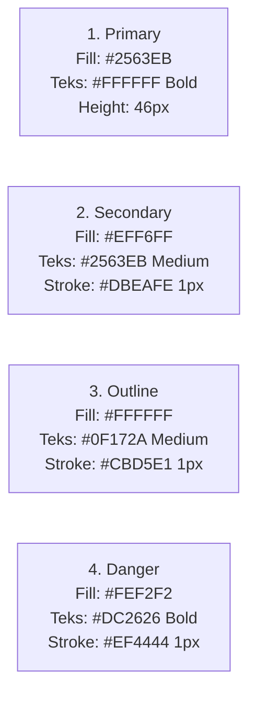

# DESIGN SYSTEM DOCUMENTATION (HIGH-FIDELITY)
## TEMAN SEBAYA — RUANG KONSELING INKLUSIF REMAJA
### Single Source of Truth: Design Tokens, Components, Auto Layout & Visual Standards

> **Dokumen ID**: `DS-TS-003-REV2`  
> **Status Dokumen**: 🟢 **APPROVED / MASTER IMPLEMENTED**  
> **Platform Target**: Mobile Android Standard (Dimensi Kanvas Acuan: 412 × 917 px)  
> **Halaman Desain Resmi**: Single Page Rule — Page `Hi-fi Design` (Page ID `1821`) pada `teman-sebaya.figcraft`  
> **Status Implementasi**: 32 Mobile Screens (Row 1 s/d 8), 116 Active Prototype Interactions  
> **Acuan Identitas**: Logo Resmi Teman Sebaya, Referensi Mental Wellness Modern, Desain Interaktif FigCraft

---

## 1. DESIGN PRINCIPLES (PRINSIP DESAIN UTAMA)

1. **Modern Friendly Digital Companion**: Menggabungkan kesegaran visual aplikasi modern dengan kehangatan sahabat yang empatik, aman, dan mudah didekati oleh remaja usia 13–19 tahun.
2. **Light, Clean & Calming Surface**: Menghindari dominasi abu-abu kusam wireframe. Menggunakan latar belakang terang, putih bersih, dan aksen pastel lembut yang memberikan efek menenangkan secara visual (*emotionally regulating*).
3. **Structured Hierarchy & Generous Whitespace**: Informasi dikelompokkan dalam kartu-kartu ber-Auto Layout rapi dengan sudut membulat (*rounded corners*), internal padding proporsional, dan jeda antar-elemen yang lapang.
4. **Strict Auto Layout & Text Wrapping Discipline**: Setiap wadah konten wajib menggunakan Auto Layout native (`vertical`/`horizontal`). Setiap node teks berbaris ganda memiliki batas lebar eksplisit (`328 px` pada layar, `296 px` di dalam kartu) untuk mencegah teks melebar horizontal atau terpotong liar.
5. **Safety-First & Crisis Readability**: Elemen keselamatan, nomor darurat krisis 119, dan penafian etis AI memiliki rasio kontras visual tertinggi yang mudah diakses dalam 1 sentuhan tanpa distraksi.

---

## 2. COLOR PALETTE & DESIGN TOKENS

### 2.1. Brand Colors (Berasal dari Logo Resmi Teman Sebaya)

| Token Name | Hex Code | Deskripsi & Peran Desain |
| :--- | :--- | :--- |
| `brand-blue-500` | `#3B82F6` | **Primary Brand Color**: Biru dinamis dan terpercaya, turunan langsung teks "TEMAN" pada logo. |
| `brand-blue-600` | `#2563EB` | **Primary Interactive/Hover**: Status sentuh tombol utama, header aktif, ikon prioritas. |
| `brand-blue-700` | `#1D4ED8` | **Primary Dark/Pressed**: Penekanan tombol, kontras tinggi teks tautan. |
| `brand-blue-100` | `#DBEAFE` | **Primary Tint/Soft Fill**: Background pill filter aktif, aksen badge, sorotan lembut. |
| `brand-blue-50` | `#EFF6FF` | **Primary Surface**: Surface kartu fitur utama, wadah ikon modul Teman Sebaya. |
| `brand-green-500`| `#10B981` | **Secondary Brand Color**: Hijau segar dan menenangkan, turunan teks "SEBAYA" pada logo. |
| `brand-green-600`| `#059669` | **Secondary Dark**: Teks status konfirmasi catatan berhasil, lencana capaian positif. |
| `brand-green-100`| `#D1FAE5` | **Secondary Tint**: Background feedback catatan emosi tersimpan, pill sukses kuis. |
| `brand-green-50` | `#ECFDF5` | **Secondary Surface**: Latar belakang kartu refleksi positif dan pencapaian kebiasaan. |

### 2.2. Supporting & Accent Colors (Aksen Ramah Remaja)

| Token Name | Hex Code | Deskripsi & Peran Desain |
| :--- | :--- | :--- |
| `accent-peach-500`| `#F97316` | **Warm Peach / Coral**: Turunan rona wajah maskot logo, memberi rasa hangat dan bersahabat. |
| `accent-peach-100`| `#FFEDD5` | **Peach Tint**: Background kartu "Catatan Hari Ini", sorotan motivasi harian. |
| `accent-amber-500`| `#F59E0B` | **Sunshine Yellow**: Aksen edukatif, ikon matahari refleksi pagi, penanda tantangan. |
| `accent-amber-100`| `#FEF3C7` | **Amber Tint**: Background kartu informasi eksplorasi minat dan karier. |
| `accent-violet-500`| `#8B5CF6` | **Gentle Lavender**: Aksen mindful, meditasi pernapasan 4-7-8, kartu refleksi malam. |
| `accent-violet-100`| `#EDE9FE` | **Lavender Tint**: Background kartu panduan relaksasi mandiri di Teman Cerita. |

### 2.3. Neutral Palette (Slate & Canvas Hierarchy)

| Token Name | Hex Code | Deskripsi & Peran Desain |
| :--- | :--- | :--- |
| `canvas-bg` | `#F8FAFC` | **Main Screen Surface**: Background layar utama mobile (Slate 50), bersih dan tidak silau. |
| `surface-white` | `#FFFFFF` | **Card & Modal Surface**: Latar belakang kartu portal, input box, dialog pop-up. |
| `surface-alt` | `#F1F5F9` | **Secondary Container**: Latar tombol sekunder, pill filter tidak aktif, kotak balasan AI. |
| `border-light` | `#E2E8F0` | **Subtle Stroke**: Garis pembatas kartu halus ($1\text{ px}$ inside), pembatas header atas. |
| `border-medium` | `#CBD5E1` | **Input & Card Border**: Stroke input form interaktif, stroke kartu aksi utama. |
| `text-primary` | `#0F172A` | **High Contrast Text**: Teks judul layar, judul kartu utama, label tombol kontras tinggi. |
| `text-secondary`| `#334155` | **Body Regular Text**: Paragraf penjelasan, label form input, subjudul kartu. |
| `text-muted` | `#64748B` | **Meta & Caption Text**: Teks bantuan, penafian kecil, label tab inaktif. |
| `text-placeholder`| `#94A3B8`| **Placeholder & Chevron**: Placeholder kotak ketik pesan, icon panah sekunder. |

### 2.4. Semantic Colors (Status & Feedback)

| Token Name | Hex Code | Deskripsi & Peran Desain |
| :--- | :--- | :--- |
| `feedback-success-bg` | `#F0FDF4` | Background kartu notifikasi emosi berhasil disimpan (`SCR-007-A`). |
| `feedback-success-border`| `#86EFAC` | Stroke kartu catatan tersimpan ($1\text{ px}$). |
| `feedback-success-text` | `#15803D` | Teks judul konfirmasi sukses ("Catatan Tersimpan: Tenang"). |
| `crisis-danger-bg` | `#FEF2F2` | Background banner darurat, tombol krisis merah, modal darurat. |
| `crisis-danger-border` | `#EF4444` | Stroke tombol darurat krisis ($1\text{ px}$). |
| `crisis-danger-text` | `#DC2626` | Teks darurat, icon peringatan segitiga krisis, nomor 119. |
| `crisis-danger-dark` | `#991B1B` | Judul modal bantuan krisis darurat. |

---

## 3. TYPOGRAPHY SYSTEM

### 3.1. Typeface Family
- **Primary Brand Typeface (Headings & Display)**: `Baloo 2` (Hero headings, page titles, section headings, important feature titles, mood headings, dan editorial highlights — memberikan kehangatan bersahabat dan karakter youthful).
- **Secondary UI Typeface (Interface & Body)**: `Inter` / `Plus Jakarta Sans` (Body text, navigasi, tombol kontrol, label form input, teks pendukung, keterangan, dan data numerik — menjamin keterbacaan tinggi di berbagai ukuran layar mobile).

### 3.2. Type Scale & Hierarchy

| Skala Tipografi | Ukuran (Size) | Bobot (Weight) | Line Height | Warna Baku | Wrapping Rule |
| :--- | :--- | :--- | :--- | :--- | :--- |
| **Display Hero** | `24 px` | Bold (700) | `32 px` | `#0F172A` / `#FFFFFF` | Center / Left, width `328 px`. |
| **Screen Title** | `20 px` | Bold (700) | `28 px` | `#0F172A` | Left, width `328 px`. |
| **Section Title** | `16 px` | SemiBold (600)| `24 px` | `#0F172A` | Hug di baris / width `328 px`. |
| **Card Heading** | `14 px` | Bold (700) | `20 px` | `#0F172A` | Inside card, **width `296 px`**. |
| **Body Regular** | `13 px` | Regular (400) | `19 px` | `#334155` | Inside card, **width `296 px`**. |
| **Body Small** | `12 px` | Regular (400) | `18 px` | `#475569` | Text wrapping `296 px`. |
| **Button Text** | `13 px` | SemiBold (600)| `18 px` | `#FFFFFF` / `#0F172A` | Single line, no wrapping. |
| **Input Label** | `12 px` | Medium (500) | `16 px` | `#334155` | Fixed container width `328 px`. |
| **Badge / Pill Tag**| `11 px` | Medium (500) | `14 px` | `#334155` / `#1D4ED8` | Inside pill, hug content. |
| **Caption & Meta** | `10.5 px`| Regular (400) | `15 px` | `#64748B` | Text wrapping `296–328 px`. |

---

## 4. SPACING, GRID & VIEWPORT

### 4.1. Spacing Scale (Sistem Kelipatan 4 & 8)

```
4px (XS)  ── 8px (SM) ── 12px (MD) ── 16px (LG) ── 20px (XL) ── 24px (2XL) ── 32px (3XL)
```
- `4 px`: Jarak mikro icon ke teks dalam badge, gap indikator titik.
- `8 px`: Gap horizontal antar-tombol, jarak internal label ke input, padding badge.
- `12 px`: **Standard Vertical Gap** dalam *Main Content Stack* antar-kartu utama.
- `16 px`: **Standard Screen Margin** (kiri & kanan layar) serta internal padding kartu (`[14, 16, 14, 16]`).
- `20–24 px`: Padding internal dialog konfirmasi modal dan hero banner.
- `32 px`: Pemisah antar-section besar (misal: Header section ke Content stack).

### 4.2. Viewport & Column Grid Specification
- **Lebar Layar Mobile Standar**: `360 px` (Baseline Android).
- **Tinggi Layar Standar**: `800 px` (Dapat bertambah dinamis menyesuaikan panjang konten: `840 px`, `960 px`, `1032 px`, `1108 px`).
- **Native Layout Grid**:
  - Kolom: `4` kolom
  - Margin Kiri/Kanan: `16 px`
  - Gutter Antar-kolom: `16 px`
  - Lebar Efektif Konten: `328 px` ($360 - 32$).

---

## 5. CORNER RADIUS & ELEVATION

### 5.1. Corner Radius Tokens
- `6 px`: Checkbox kotak, status tag mikro.
- `8 px`: Tombol utama, kotak input form, tombol kembali sub-halaman.
- `12–14 px`: **Standard Card Radius** (Kartu portal, kartu artikel, kartu ringkasan).
- `16–20 px`: Hero banner visual, wadah modal dialog pop-up, kartu statistik emosi.
- `9999 px (Full Pill)`: Chip filter pencarian, tombol darurat krisis, pemilih bahasa.

### 5.2. Elevation & Shadow Hierarchy
- **Level 0 (Flat)**: Input field, button ghost, card internal stack.
- **Level 1 (Subtle Card Elevation)**:
  `box-shadow: 0px 1px 3px rgba(15, 23, 42, 0.05), 0px 1px 2px rgba(15, 23, 42, 0.03)`
  Digunakan pada kartu portal konten dan kartu pemilih emosi harian.
- **Level 2 (Floating Action / Sticky Bar)**:
  `box-shadow: 0px 4px 12px rgba(15, 23, 42, 0.08)`
  Digunakan pada Bottom Navigation Bar dan Floating Action Buttons.
- **Level 3 (Modal Backdrop & Dialog)**:
  `box-shadow: 0px 12px 32px rgba(15, 23, 42, 0.16)`
  Digunakan pada Dialog Konfirmasi Logout dan Modal Bantuan Darurat 119.

---

## 6. ICONOGRAPHY SYSTEM (LUCIDE SVG VECTORS)

Seluruh ikon antarmuka wajib menggunakan path vektor SVG Lucide native dengan ketebalan garis (*stroke weight*) seragam **2.0 px** (stroke 1.8 px untuk ikon inaktif pada navigasi bawah).

### 6.1. Registri Ikon Vektor Aktif

| Nama Ikon | Simbol / Peran Fungsional | Ukuran Baku (px) |
| :--- | :--- | :--- |
| `home` | Tab Navigasi Beranda | 20 × 20 |
| `messageCircle`| Tab Teman Cerita & Ikon Obrolan AI | 20 × 20 |
| `bookOpen` | Tab Teman Belajar & Artikel Edukasi | 20 × 20 |
| `sprout` | Tab Teman Tumbuh & Eksplorasi Potensi | 20 × 20 |
| `compass` | Tab Teman Akses & Jalur Rujukan | 20 × 20 |
| `user` | Avatar Profil Pengguna & Akun | 18 × 18 |
| `globe` | Sakelar Pemilih Bahasa (ID \| EN) | 14 × 14 |
| `arrowLeft` | Tombol Navigasi Kembali Sub-Halaman | 16 × 16 |
| `chevronRight`| Penanda Aksi Interaktif Kartu Portal | 16 × 16 |
| `alertTriangle`| Penanda Bahaya Krisis & Tombol Darurat | 16 × 16 |
| `checkCircle` | Konfirmasi Catatan Berhasil & Kuis Benar | 18 × 18 |
| `heart` | Simbol Cinta & Refleksi Suasana Hati | 20 × 20 / 40 × 40 |
| `share2` | Tombol Bagikan Kutipan Refleksi | 16 × 16 |
| `thumbsUp` | Konfirmasi Kesesuaian Kutipan Refleksi | 22 × 22 |
| `thumbsDown` | Penolakan Kutipan / Pilih Emosi Lain | 22 × 22 |
| `send` | Tombol Kirim Pesan Kotak Obrolan | 16 × 16 |
| `eye` | Toggle Sembunyikan/Tampilkan Kata Sandi | 16 × 16 |
| `shield` | Lencana Jaminan Privasi Data Remaja | 16 × 16 |

---

## 7. STANDARDIZED COMPONENT SPECIFICATIONS

### 7.1. Global Persistent Header (`56 px`)
- **Struktur Auto Layout**: `layout: 'horizontal'`, `mainAlign: 'spaceBetween'`, `crossAlign: 'center'`, padding `[12, 16, 12, 16]`, width `360 px`, tinggi `56 px`, stroke bawah `#E2E8F0` ($1\text{ px}$).
- **Elemen Kiri**: Teks Logo `"TEMAN SEBAYA"` (`15 px Bold #0F172A`).
- **Elemen Kanan (Actions Cluster)**:
  - Language Switcher: Pill `#F1F5F9`, border `#CBD5E1`, icon `globe` 13px, teks `"ID | EN"` (`11 px Medium #334155`).
  - Profile Button: Circle 32×32 px `#EFF6FF`, border `#DBEAFE`, icon `user` 16px `#2563EB`.

### 7.2. Sub-Page Back Bar (`56 px`)
- **Struktur Auto Layout**: `layout: 'horizontal'`, `gap: 12`, `crossAlign: 'center'`, padding `[12, 16, 12, 16]`, width `360 px`, tinggi `56 px`, stroke bawah `#E2E8F0`.
- **Tombol Kembali**: Circle/Rounded container 34×34 px `#F1F5F9`, radius 8 px, border `#CBD5E1`, icon `arrowLeft` 16px `#0F172A`.
- **Judul Layar**: Teks `15 px Bold #0F172A` (contoh: `"Teman Cerita"`, `"Refleksi Emosional"`).

### 7.3. Bottom Navigation Bar (`64 px`)
- **Struktur Auto Layout**: `layout: 'horizontal'`, width `360 px`, tinggi `64 px`, background `#FFFFFF`, stroke atas `#E2E8F0` ($1\text{ px}$).
- **Distribusi 5 Tab**: 5 frame merata masing-masing selebar `72 px` ($360 / 5$).
- **Tab Aktif**:
  - Garis indikator aktif di bagian paling atas tab (lebar 28 px, tinggi 3 px, radius 2 px, warna `#2563EB`).
  - Icon Lucide stroke 2.2 px warna `#2563EB`.
  - Teks label `10 px Bold #2563EB`.
- **Tab Inaktif**:
  - Tanpa garis indikator.
  - Icon Lucide stroke 1.8 px warna `#64748B`.
  - Teks label `10 px Medium #64748B`.

### 7.4. Button Variants (Tinggi: `44–46 px`, Corner Radius: `8 px`)



### 7.5. Portal / Action Cards (`Width: 328 px`)
- **Struktur**: Auto Layout vertikal, padding `[14, 16, 14, 16]`, gap `8 px`, fill `#FFFFFF`, border `#E2E8F0` 1px, radius `12 px`, subtle elevation.
- **Top Row**: Badge kategori di sisi kiri (`fill: #EFF6FF`, teks `#2563EB` 11px Medium) + Trailing icon `chevronRight` 16px `#94A3B8` di sisi kanan.
- **Title**: `14 px Bold #0F172A`.
- **Deskripsi**: `12.5 px Regular #475569`, text wrapping **wajib `296 px`**.

### 7.6. Form Input Fields (`Height: 42 px`, Container Width: `328 px`)
- **Label**: `12 px Medium #334155`.
- **Field Box**: Fill `#FFFFFF`, border `#CBD5E1` 1px, radius `8 px`, padding `[10, 12, 10, 12]`, placeholder `12.5 px Regular #94A3B8`.
- **Password Variant**: Icon `eye` 16px `#94A3B8` disematkan di sisi kanan field.

### 7.7. Mood Selector Component (Di Beranda & Mood Flow — Master Brief Screen C02)
- **4 Emosi Primer Terstandarisasi**:
  1. *Bahagia* ("Aku sedang merasa bahagia") — Aksen Kuning/Amber Ceria.
  2. *Sedih* ("Aku sedang merasa sedih") — Aksen Biru Menenangkan.
  3. *Marah* ("Aku sedang merasa marah") — Aksen Karang/Oranye Hangat.
  4. *Biasa Saja* ("Aku merasa biasa saja") — Aksen Hijau/Teal Seimbang.
- **Grid Layout**: 2 Kolom × 2 Baris kartu emosi ramah remaja dengan sudut membulat 16 px.
- **Pill Quick-Picker (Beranda)**: 4 tombol pill emosi terstandarisasi untuk pencatatan instan.
- **Kondisi Terpilih**: Border `#2563EB` 2px, fill `#EFF6FF`, teks `#1D4ED8` Bold, indikator visual konfirmasi.

### 7.8. Capsule Bar Chart Component (Mood Statistics)
- **Container**: Fill `#FFFFFF`, border `#E2E8F0`, radius `16 px`, padding `[16, 16, 16, 16]`.
- **Y-Axis**: Label skala vertikal `100`, `80`, `50`, `20`, `0` (`10 px #94A3B8`).
- **Capsule Track**: Kapsul vertikal tinggi 140 px, lebar 38 px, radius 19 px, fill `#F1F5F9`.
- **Floating Face Node**: Lingkaran emosi berdiameter 28 px di dalam kapsul yang melayang pada ketinggian sesuai persentase data (misal: Bahagia 30%, Sedih 80%, Marah 50%).

### 7.9. Chat Interface Components
- **Balon Percakapan Pengguna**: Rata kanan, fill `#2563EB`, teks `#FFFFFF` 13px, radius `16 px` (sudut kanan bawah lancip `4 px`), padding `[10, 14, 10, 14]`, max-width `240 px`.
- **Balon Percakapan AI**: Rata kiri, fill `#F1F5F9`, border `#E2E8F0` 1px, teks `#0F172A` 13px, radius `16 px` (sudut kiri bawah lancip `4 px`), padding `[10, 14, 10, 14]`, max-width `260 px`.
- **Input Composer**: Baris bawah sticky, input field selebar 270 px + Tombol kirim bulat `#2563EB` 40×40 px dengan icon `send` putih.

### 7.10. Emergency Crisis Modal (`SCR-007-G`)
- **Struktur**: Modal pop-up selebar 320 px, fill `#FFFFFF`, radius `16 px`, padding `[20, 20, 20, 20]`, gap `12 px`.
- **Header Alert**: Icon bulat 44×44 px `#FEF2F2`, border `#FCA5A5`, icon `alertTriangle` 22px `#DC2626`.
- **Judul**: `"Butuh Bantuan Mendesak?"` (`16 px Bold #991B1B`).
- **Pilihan Kontak**:
  - Tombol Hubungi 119 Ext 8 (Kemenkes Sejiwa Bebas Pulsa) - Pill `#DC2626` teks putih.
  - Tombol Hubungi Layanan Darurat 112 / 110 - Pill `#F1F5F9` border `#CBD5E1`.
  - Tombol Batal / Kembali ke Obrolan - Text link ghost `#475569`.

---

## 8. ACCESSIBILITY (A11Y) & USAGE RULES

### 8.1. Standar Rasio Kontras (WCAG AA Compliance)
- Seluruh teks `text-primary` (`#0F172A`) terhadap `canvas-bg` (`#F8FAFC`) dan `surface-white` (`#FFFFFF`) memiliki rasio kontras **15.8:1** (Melampaui batas minimal 4.5:1).
- Teks tombol utama putih (`#FFFFFF`) terhadap `brand-blue-600` (`#2563EB`) memiliki rasio kontras **4.6:1** (Lolos WCAG AA).
- Teks krisis merah (`#DC2626`) terhadap `crisis-danger-bg` (`#FEF2F2`) memiliki rasio kontras **5.2:1** (Lolos WCAG AA).

### 8.2. Do and Don't Guidelines

| Kategori | DO (Lakukan) | DON'T (Jangan Lakukan) |
| :--- | :--- | :--- |
| **Warna** | Gunakan `brand-blue-500` (`#3B82F6`) dan `brand-green-500` (`#10B981`) sebagai identitas utama. | Jangan menggunakan skema warna ungu atau gradien neon acak yang tidak ada hubungannya dengan brand. |
| **Wireframe**| Ganti seluruh warna abu-abu kusam wireframe (`#F8FAFC` slate-50 untuk seluruh layer) dengan token high-fi terang dan kontras. | Jangan membiarkan wireframe grayscale tampil sebagai desain final aplikasi. |
| **Auto Layout**| Tentukan lebar teks multi-baris eksplisit (`width: 328` atau `296`). | Dilarang membuat layer teks tanpa batas lebar yang memanjang keluar dari kartu. |
| **Ikon** | Gunakan path vektor Lucide SVG native seragam stroke 2.0 px. | Dilarang keras memakai teks emoji (🏠, ⚠️) atau simbol kurung siku `[>]` sebagai icon. |
| **Keamanan** | Tampilkan tombol darurat dan penafian AI di setiap ruang obrolan sensitif. | Jangan pernah menyembunyikan tombol darurat atau menghilangkan disclaimer medis. |

