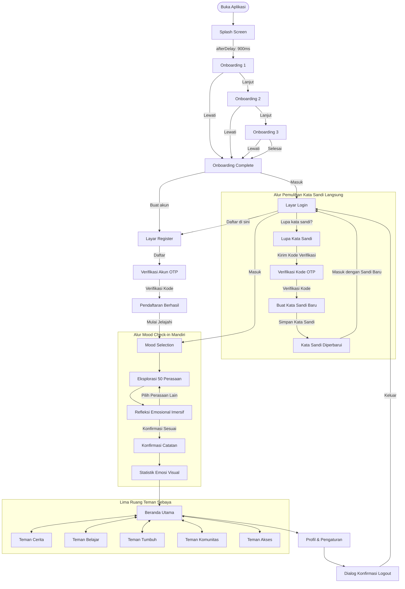
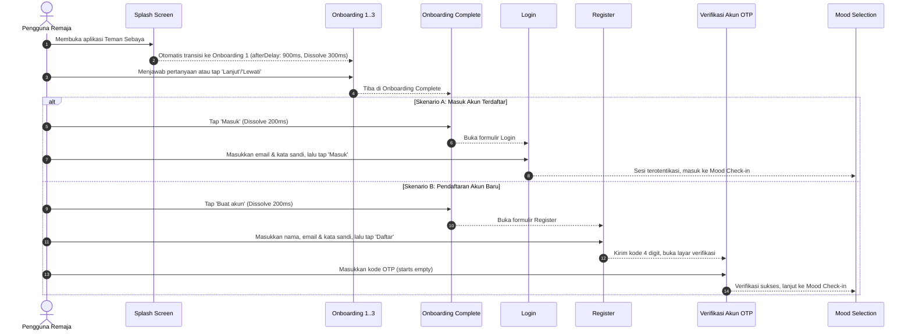
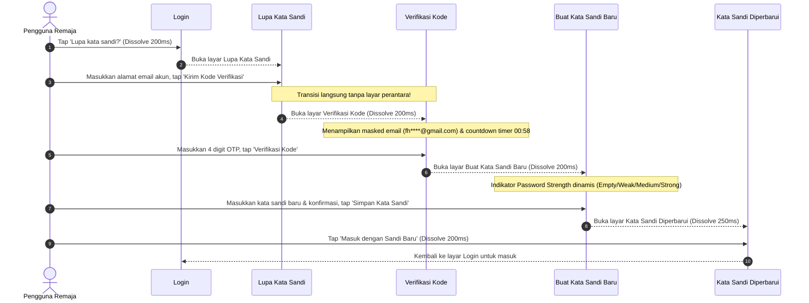

# COMPLETE USER FLOWS SPECIFICATION
## TEMAN SEBAYA — RUANG KONSELING INKLUSIF REMAJA
### Pemetaan Alur Pengguna End-to-End, Diagram Interaksi & Transisi Layar

> **Dokumen ID**: `FLOW-TS-005`  
> **Status Dokumen**: 🟢 **VERIFIED / HIGH-FIDELITY IMPLEMENTATION**  
> **Platform Target**: Mobile Android & iOS (412 × 917 px & 360 × 800 px)  
> **Lokasi File**: `markdown/prototype/user_flows.md`  
> **Tujuan**: Menjamin seluruh alur terhubung secara logis tanpa adanya halaman buntu (*zero dead-end navigation*).

---

## 1. GLOBAL USER FLOW OVERVIEW

Alur perjalanan pengguna Teman Sebaya dirancang mengutamakan kemudahan akses (*low friction*), kenyamanan emosional (*emotional safety*), dan kejelasan navigasi (*clear wayfinding*):

---

## 2. DETAIL USER FLOW PER MODUL

### 2.1. Alur 01: Entry, Onboarding & Autentikasi

### 2.2. Alur 02: Pemulihan Kata Sandi Langsung (Direct Password Recovery)

Alur pemulihan kata sandi direkonstruksi untuk menghilangkan layar jeda (*intermediate friction screen*) `Recovery Submitted`:

#### Kebijakan Keamanan & Anti-Enumeration:
1. **Masked Recipient Display**: Email disamarkan sebagian (`fh****@gmail.com`) untuk menjaga privasi visual pengguna di ruang publik.
2. **Anti-Account Enumeration Copy**: Salinan instruksi menggunakan kalimat terbuka: *"Jika email terdaftar, kode verifikasi akan segera masuk ke kotak pesan."* Hal ini mencegah pihak tak berwenang memvalidasi keberadaan akun orang lain.
3. **Pemberian Waktu Jeda Resend**: Timer countdown 58 detik ("Kirim ulang dalam 00:58") mencegah serangan brute force atau spamming permintaan OTP.

---

## 3. MOOD CHECK-IN FLOW & CORE SPACES

(Sesuai implementasi Page 1195 `Mood Check-in Flow` dan Page 1 `Teman Sebaya Core Spaces`).
