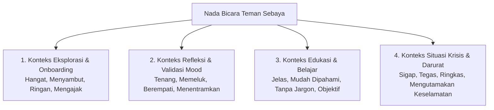

# UX WRITING GUIDELINES & CONTENT STANDARDS
## TEMAN SEBAYA — RUANG KONSELING INKLUSIF REMAJA
### Brand Voice, Tone of Voice, Kamus Istilah, Copywriting Komponen & Panduan Penafian Etis

> **Dokumen ID**: `UXW-TS-006`  
> **Status Dokumen**: 🟡 **PROPOSED / EDITORIAL BASELINE**  
> **Bahasa Baku**: Bahasa Indonesia Ragam Santun, Hangat & Alami untuk Remaja (Non-Slang Berlebihan, Bebas Jargon Klinis)  
> **Lokasi File**: `markdown/prototype/ux_writing.md`  
> **Tujuan**: Menjamin seluruh teks antarmuka konsisten, empatik, menenangkan, dan patuh pada etika kesehatan mental remaja.

---

## 1. BRAND VOICE & EDITORIAL IDENTITY

### 1.1. Suara Brand (Brand Voice)
Suara Teman Sebaya diibaratkan sebagai **seorang kawan sebaya yang tulus, dewasa, tenang, dan dapat dipercaya**. Karakter suaranya memiliki atribut:

- **Mendengarkan Penuh (Actively Listening)**: Tidak langsung memotong atau memaksakan solusi cepat saat remaja bercerita.
- **Validatif Tanpa Menghakimi (Validating & Non-Judgmental)**: Menghargai semua perasaan—baik rasa senang, takut, marah, maupun lelah—sebagai hal yang wajar dirasakan manusia.
- **Setara & Tidak Menggurui (Peer-to-Peer & Non-Patronizing)**: Menggunakan sudut pandang kawan diskusi, bukan dosen penguji, polisi moral, atau dokter yang sedang memeriksa pasien.
- **Jelas & Terus Terang (Clear & Transparent)**: Terbuka tentang kemampuan dan batasan teknologi AI serta selalu sigap mengarahkan ke tenaga profesional saat keadaan darurat.

### 1.2. Nada Bicara Berdasarkan Konteks (Tone of Voice by Context)

---

## 2. WRITING PRINCIPLES FOR TEEN MENTAL WELLNESS

1. **Gunakan Kata Ganti yang Bersahabat**:
   - Gunakan sapaan `"Kamu"` atau `"Sobat Sebaya"`. Hindari kata kaku `"Anda"` (terlalu korporat/formal) atau kata gaul yang cepat usang (*slang* berlebihan yang terkesan dibuat-buat).
2. **Hindari Memberi Label Diagnosis**:
   - ❌ *DILARANG*: "Kamu terindikasi menderita gangguan kecemasan menyeluruh (GAD)."
   - ✅ *GUNAKAN*: "Wajar jika rasa cemas ini terasa berat buatmu saat ini. Mari kita urai perlahan apa yang paling mengganggumu."
3. **Posisikan Kesalahan Bukan Sebagai Kegagalan**:
   - Pada hasil kuis yang salah:
   - ❌ *DILARANG*: "Jawaban Anda salah total! Anda belum lulus standar materi."
   - ✅ *GUNAKAN*: "Tidak apa-apa, kamu bisa membaca kembali ringkasan materinya dan mencoba lagi dengan santai."
4. **Hindari Bahasa Pengembangan (Development Jargon)**:
   - Dilarang keras menampilkan kata: *demo, simulasi, dummy data, testing, sample, placeholder, preview, mockup* pada antarmuka pengguna sejati. Gunakan istilah fungsional nyata (*"Contoh kegiatan binaan"*, *"Respons otomatis untuk latihan"*).

---

## 3. TERMINOLOGY DICTIONARY (KAMUS ISTILAH BAKU)

| Istilah Terlarang / Dihindari | Istilah Resmi Teman Sebaya | Alasan & Konteks Penggunaan |
| :--- | :--- | :--- |
| *Pasien / Klien* | **Teman / Pengguna / Sobat Sebaya** | Menghilangkan stigma medis kaku; memposisikan remaja sebagai individu berdaya. |
| *Penyakit Jiwa / Gangguan Mental* | **Tantangan Emosi / Kesehatan Mental** | Bahasa yang lebih empatik, edukatif, dan tidak melabeli individu. |
| *Bot / Robot AI* | **Asisten AI / Teman Cerita** | Menjelaskan teknologi secara ramah namun tetap jujur dan transparan. |
| *Ruang Periksa / Poli Jiwa* | **Jalur Bantuan / Layanan Profesional**| Mengurangi kecemasan remaja saat mencari pertolongan medis. |
| *Diagnosis / Hasil Tes Psikologi* | **Refleksi Diri / Eksplorasi Minat** | Menegaskan bahwa fitur mandiri aplikasi bukan pengganti evaluasi klinis resmi. |
| *Submit / Kirim Data* | **Simpan Catatan / Kirim Cerita** | Kata aksi yang lebih bermakna emosional dan manusiawi. |
| *Sign In / Sign Up* | **Masuk / Daftar Akun** | Mengutamakan Bahasa Indonesia yang natural dan mudah dipahami. |

---

## 4. COMPONENT COPYWRITING SPECIFICATIONS

### 4.1. Global Header & Navigasi Utama
- **Brand Title**: `"TEMAN SEBAYA"`
- **Language Switcher**: `"ID | EN"`
- **Profil Navigasi**: `"Profil Saya"`, `"Pengaturan Akun"`, `"Pusat Bantuan"`
- **Tab Navigasi Bawah**:
  1. `Beranda` (Halaman utama)
  2. `Cerita` (Ruang obrolan asisten AI)
  3. `Belajar` (Artikel psikoedukasi & kuis)
  4. `Tumbuh` (Minat, potensi & tantangan harian)
  5. `Akses` (Panduan jalur rujukan bantuan)

### 4.2. Tombol Aksi Utama (Buttons & Calls to Action)
- **Tombol Masuk Cepat**: `"Lanjut sebagai Tamu"`
- **Tombol Utama Auth**: `"Masuk"`, `"Daftar Sekarang"`, `"Kirim Kode Verifikasi"`
- **Tombol Mood Check-in**:
  - Konfirmasi Refleksi Sesuai: `"Ya, mewakili perasaanku"` / Ikon jempol ke atas
  - Penolakan / Ganti Emosi: `"Belum, pilih perasaan lain"` / Ikon jempol ke bawah
  - Simpan Jurnal: `"Simpan Catatan Suasana Hati"`
  - Menuju Dashboard: `"Lanjut ke Beranda"`
- **Tombol Darurat**: `"Bantuan Darurat"` / `"Hubungi 119 Ext 8"`

### 4.3. Penafian Keselamatan Wajib (Mandatory Safety Disclaimers)

Berikut adalah kalimat penafian etis yang wajib dipertahankan secara utuh pada modul-modul terkait:

#### A. Penafian Asisten Obrolan AI (Teman Cerita)
> *"Percakapan ini diproses oleh asisten AI untuk membantumu merapikan pikiran, bukan konseling psikologis atau medis sungguhan. Jangan bagikan informasi pribadi yang sangat rahasia."*

#### B. Penafian Catatan Emosi Harian (Mood Check-in & Beranda)
> *"Pencatatan suasana hati ini berfungsi sebagai sarana refleksi mandiri untuk mengenali pola emosi diri, bukan penilaian kesehatan jiwa klinis."*

#### C. Penafian Panduan Jalur Rujukan (Teman Akses)
> *"Teman Sebaya bukan layanan tanggap darurat medis. Jika kamu atau temanmu berada dalam situasi krisis atau ancaman keselamatan yang mendesak, segera hubungi layanan darurat 119 atau cari bantuan langsung dari orang dewasa tepercaya di sekitarmu."*

#### D. Penafian Eksplorasi Minat & Karier (Teman Tumbuh)
> *"Hasil penelusuran minat dan kekuatan ini merupakan inspirasi langkah awal eksplorasi dirimu, bukan penilaian bakat psikometrik formal."*

#### E. Penafian Wadah Komunitas (Teman Komunitas)
> *"Profil kegiatan kelompok binaan PIK-R dan Forum GenRe ditampilkan sebagai sarana edukasi keterhubungan sebaya. Jadwal dan kegiatan resmi dapat dipastikan melalui kanal instansi terkait setempat."*

---

## 5. FEEDBACK, ERROR & EMPTY STATES COPYWRITING

### 5.1. Pesan Validasi Formulir & Error
- **Format Email Tidak Sah**: `"Pastikan alamat email yang kamu masukkan sudah benar ya (contoh: nama@email.com)."`
- **Kata Sandi Kurang Panjang**: `"Kata sandi minimal 8 karakter agar akunmu tetap terlindungi dengan aman."`
- **Kode OTP Salah**: `"Kode verifikasi belum sesuai. Periksa kembali kotak masuk email atau SMS kamu, ya."`
- **Gagal Memuat Respon Obrolan**: `"Koneksi internetmu sedang terputus sejenak. Jangan khawatir, ceritamu tidak hilang. Coba ketuk kirim ulang."`

### 5.2. Pesan Keberhasilan (Success Feedback)
- **Mood Tercatat (Beranda `SCR-007-A`)**:
  - Judul: `"Catatan Tersimpan: Tenang"`
  - Deskripsi: `"Senang mendengarnya! Menjaga ketenangan pikiran adalah modal baik untuk beraktivitas hari ini."`
- **Penyelesaian Kuis Sempurna (Teman Belajar `SCR-008-A`)**:
  - Judul: `"Hebat! 3 dari 3 Jawaban Benar"`
  - Deskripsi: `"Keren, Sobat Sebaya! Kamu sudah memahami langkah-langkah dasar menjaga kesehatan mental diri dengan sangat baik."`
- **Penyelesaian Kuis Mengulang (Teman Belajar `SCR-008-B`)**:
  - Judul: `"Tidak Apa-apa, Mari Belajar Bersama"`
  - Deskripsi: `"Menemukan jawaban yang tepat butuh proses. Baca kembali artikel singkat di atas, lalu coba kuisnya lagi kapan pun kamu siap."`

### 5.3. Pesan Status Kosong (Empty States)
- **Riwayat Mood Baru Pertama Kali (`MC-015`)**:
  - Judul: `"Langkah Pertama Menuju Kesadaran Diri"`
  - Deskripsi: `"Kamu baru saja mencatat suasana hati pertamamu hari ini. Terus kenali perasaanmu setiap hari untuk melihat pola perjalanan emosimu."`
- **Pencarian Topik Cerita Tidak Ditemukan**:
  - Judul: `"Topik Cerita Belum Tersedia"`
  - Deskripsi: `"Kamu bisa menuliskan ceritamu secara bebas di kolom pesan bawah, atau pilih salah satu topik umum yang paling mendekati apa yang kamu rasakan."`

