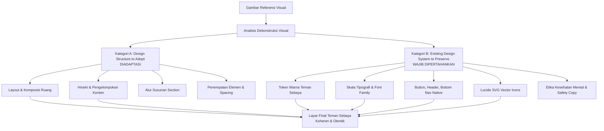
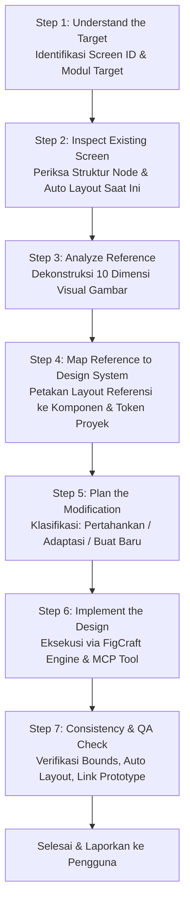

# REFERENCE DESIGN GUIDELINES
## Panduan Operasional Penerapan Referensi Desain UI ke dalam Design System Teman Sebaya

> **Status Dokumen**: 🟢 **Aktif & Wajib Dipatuhi (Mandatory Operational Manual)**  
> **Lokasi File**: `REFERENCE_DESIGN_GUIDELINES.md` (Root Project)  
> **Platform Target**: Mobile Android-First (Dimensi Layar Acuan: 360 × 800 px)  
> **Tool Integrasi**: FigCraft Desktop Engine via MCP / CLI (Live Port 7979)  
> **File Kanvas Utama**: [`teman-sebaya.figcraft`](file:///c:/Users/Fhazar/Fhazar_Workspace/02_PROJECTS/teman-sebaya/teman-sebaya.figcraft)  
> **Prinsip Utama**:  
> **"Use the reference for design direction, not as a replacement for the existing design system."**

---

## 1. PURPOSE AND SCOPE

### 1.1. Tujuan Dokumen
Dokumen ini merupakan pedoman operasional permanen untuk **AI Coding/Design Agent** dalam mengolah, menganalisis, dan mengimplementasikan referensi desain visual (screenshot aplikasi nyata, eksplorasi Dribbble, Behance, Pinterest, dsb.) ke dalam aplikasi **Teman Sebaya**.

Dokumen ini **bukan** dokumentasi teori UI/UX umum, melainkan **aturan kerja teknis dan presisi** agar setiap evolusi antarmuka:
1. Memanfaatkan kekuatan visual referensi (arah layout, komposisi, spatial grouping, hirarki konten).
2. Mempertahankan 100% identitas visual, token warna, tipografi, dan perilaku komponen aplikasi yang sudah terpasang.
3. Menjamin hasil akhir terlihat dan terasa sebagai bagian organik dari ekosistem Teman Sebaya, bukan hasil kloning tempel (*patchwork*) dari aplikasi lain.

### 1.2. Cakupan Operasional
- **Berlaku untuk**: Seluruh permintaan perubahan desain yang disertai gambar referensi, perbaikan layar parsial, penambahan variasi komponen, maupun rekonstruksi alur modul.
- **Batasan Mutlak**: Perubahan berbasis referensi hanya boleh memengaruhi **layar/bagian yang ditargetkan secara eksplisit oleh pengguna**. Dilarang merombak desain global atau memodifikasi layar lain di luar lingkup tugas.

---

## 2. EXISTING APPLICATION DESIGN SYSTEM

Seluruh implementasi desain berbasis referensi **wajib** menggunakan token dan komponen yang telah aktif di dalam project ini. Jangan mengarang token warna atau ukuran baru.

### 2.1. Viewport, Canvas & Layout Grid
- **Dimensi Lebar Kanvas (Fixed)**: `360 px` (Baseline Android Mobile).
- **Dimensi Tinggi Kanvas Standar**: `800 px` (Dapat menyesuaikan volume konten: `840 px`, `920 px`, `960 px`, `1032 px`, `1108 px`).
- **Layout Grid Native**:
  - `kind`: `columns`
  - `count`: `4` kolom
  - `offset`: `16 px` (Margin kiri & kanan)
  - `gutter`: `16 px`
  - `align`: `stretch`
- **Lebar Kerja Efektif Konten (Content Boundary)**: `328 px` ($360 - 2 \times 16$).
- **Lebar Maksimal Teks dalam Card**: `296 px` ($328 - 2 \times 16\text{ internal padding}$).

### 2.2. Color Palette & Design Tokens (Hex Codes Aktual)

| Kategori Token | Nama Token | Nilai Hex | Peran & Penggunaan |
| :--- | :--- | :--- | :--- |
| **Primary Brand** | `slate-900` | `#0F172A` | Teks judul utama, border aktif, background tombol primary, icon aktif. |
| **Secondary Brand** | `slate-800` | `#1E293B` | Background header splash, fill tombol dark, kontras elevasi. |
| **Body & Subtitles** | `slate-700` | `#334155` | Label form input, badge teks gelap, teks penjelas medium. |
| **Body Secondary** | `slate-600` | `#475569` | Paragraf deskripsi kartu, body text umum, tombol ghost text. |
| **Muted & Meta** | `slate-500` | `#64748B` | Ikon tab tidak aktif, meta text, catatan hak cipta/footer. |
| **Placeholder & Border**| `slate-400` | `#94A3B8` | Placeholder form input, icon chevron sekunder, outline border netral. |
| **Card Borders** | `slate-300` | `#CBD5E1` | Stroke pembatas kartu ($1\text{ px}$ inside), border input box, divider bar. |
| **Header Border** | `slate-200` | `#E2E8F0` | Stroke bawah header persistent bar ($1\text{ px}$), background avatar circle. |
| **Surface Alt** | `slate-100` | `#F1F5F9` | Background tombol sekunder, pill filter, background tombol kembali. |
| **Surface Base** | `slate-50` | `#F8FAFC` | Surface kartu sekunder (mood logger, notice card, active bottom tab). |
| **Canvas Surface** | `white` | `#FFFFFF` | Background utama layar, kartu portal konten, background input aktif. |
| **Crisis Danger Fill** | `red-50` | `#FEF2F2` | Background banner darurat, kartu krisis, tombol aksi bahaya. |
| **Crisis Border** | `red-500` | `#EF4444` | Stroke pill darurat krisis, stroke konfirmasi keluar. |
| **Crisis Text/Icon** | `red-600` | `#DC2626` | Teks darurat, icon peringatan krisis, icon log out modal. |
| **Crisis Text Dark** | `red-800` | `#991B1B` | Judul kartu rujukan darurat, teks peringatan hotline 24 jam. |
| **Success/Saved Fill**| `green-50` | `#F0FDF4` | Background feedback mood tersimpan, badge terverifikasi BPJS. |
| **Success Border** | `green-300` | `#86EFAC` | Stroke kartu feedback catatan emosi harian ($1\text{ px}$). |
| **Success Text** | `green-700` | `#15803D` | Teks judul konfirmasi catatan berhasil disimpan. |
| **Success Dot** | `emerald-500`| `#10B981` | Indikator status online asisten AI (`• Asisten AI · Online`). |
| **Brand Accent** | `sky-400` | `#38BDF8` | Ikon pelindung privasi pada banner splash screen. |

### 2.3. Typography Hierarchy & Rules

Font platform menggunakan sans-serif modern (Inter / Roboto / System UI).

| Skala Tipografi | Ukuran (Size) | Ketebalan (Weight) | Fill Warna | Auto Resize & Wrapping |
| :--- | :--- | :--- | :--- | :--- |
| **Display Brand** | `22 px` | `Bold` | `#FFFFFF` / `#0F172A` | Fixed width `328 px`, center / left. |
| **Screen Title** | `18–20 px` | `Bold` | `#0F172A` | Fixed width `328 px`, text wrapping. |
| **Section Title** | `14–15 px` | `Bold` | `#0F172A` | Fixed width `328 px` / `hug` di header bar. |
| **Subhead / Card Title**| `13–14 px` | `Bold` | `#0F172A` | Inside card, text wrapping `296 px`. |
| **Input Label** | `11–12 px` | `Medium` | `#334155` | Fixed width container input. |
| **Body Regular** | `11.5–12 px` | `Regular` | `#475569` | Inside card, **wajib wrapping `296 px`**. |
| **Button Text** | `11.5–12 px` | `Medium` / `Bold`| `#FFFFFF` / `#0F172A` | Centered / Spaced, no wrapping. |
| **Caption / Meta** | `10–10.5 px` | `Regular` | `#64748B` | Text wrapping `296–328 px`. |
| **Badge / Tag** | `10–11 px` | `Medium` | `#0F172A` / `#334155` | Inside badge container, `hug content`. |

> **Aturan Wajib Text Wrapping**: Setiap text node multi-baris di FigCraft **wajib memiliki parameter `width` eksplisit** (`width: 328` untuk layar atau `width: 296` untuk di dalam kartu ber-padding 16px). Dilarang membuat text layer tanpa width yang memanjang horizontal melebihi 328px!

### 2.4. Spacing System (Kelipatan 4 & 8)
- `4 px`: Gap mikro antar icon & teks badge, gap indikator stepper.
- `6 px`: Gap internal elemen judul kartu & deskripsi, gap antar baris info.
- `8 px`: Gap tombol horizontal, gap antar pilihan mood / filter pill, padding horizontal badge.
- `10–12 px`: **Standard Vertical Gap** antar kartu dalam `Main Content Stack`.
- `14–16 px`: Standard Card Padding (`padding: [14, 16, 14, 16]`).
- `16 px`: Standard Screen Margin kiri & kanan.
- `20 px`: Padding modal dialog konfirmasi.

### 2.5. Border Radius Hierarchy
- `4–6 px`: Checkbox (`4 px`), Status Badge & Tags (`6 px`).
- `8 px`: Tombol utama, input field box, sub-page back button, alert/feedback card.
- `10–12 px`: Portal card utama, interactive card, article card.
- `16 px`: Hero visual card (Onboarding), Dialog Modal box.
- `14–17 px (Pill)`: Chip filter pencarian, tombol darurat krisis, language selector.
- `50% (Circle)`: Avatar bulat, icon container bulat ($size / 2$).

### 2.6. Standard Component Specifications

#### A. Persistent Global Header (`56 px`)
- **Struktur**: Frame selebar `360 px`, tinggi `56 px`, Auto Layout `horizontal`, `mainAlign: 'spaceBetween'`, `crossAlign: 'center'`, padding `[12, 16, 12, 16]`, stroke `#E2E8F0` bawah.
- **Kiri**: Brand Title `"TEMAN SEBAYA"` atau nama modul (`15 px Bold #0F172A`).
- **Kanan**: Header Actions Row:
  - Language Switcher Badge: Pill `#F1F5F9`, border `#CBD5E1`, icon `globe` 13px, teks `"ID | EN"`.
  - Profile Avatar Button: Circle 30×30 px `#E2E8F0`, icon `user` 16px `#0F172A`, interaksi membuka `SCR-012`.

#### B. Sub-Page Back Bar (`56 px`)
- **Struktur**: Frame selebar `360 px`, tinggi `56 px`, Auto Layout `horizontal`, gap `12 px`, padding `[12, 16, 12, 16]`, stroke `#E2E8F0`.
- **Kiri**: Back Button container 34×32 px `#F1F5F9`, radius 8 px, border `#CBD5E1`, icon `arrowLeft` 16px.
- **Tengah/Kanan**: Page Title (`15 px Bold #0F172A`).

#### C. Bottom Navigation Bar (`64 px`)
- **Struktur**: Frame selebar `360 px`, tinggi `64 px`, Auto Layout `horizontal`, stroke `#CBD5E1` atas, background `#FFFFFF`.
- **Items**: 5 tab merata masing-masing selebar `72 px` ($360 / 5$):
  1. `Beranda` (Icon `home`)
  2. `Cerita` (Icon `messageCircle`)
  3. `Belajar` (Icon `bookOpen`)
  4. `Tumbuh` (Icon `sprout`)
  5. `Akses` (Icon `compass`)
- **Status Aktif**: Active indicator line di bagian atas tab (lebar 28 px, tinggi 3 px, warna `#0F172A`), teks bold `#0F172A`, stroke icon 2.2px. Status inaktif: tanpa bar, warna `#64748B`, stroke icon 1.8px.

#### D. Button Variants (`Height: 38–46 px`, Corner Radius: `8 px`)
1. **Primary**: Fill `#1E293B`, teks `#FFFFFF` Medium/Bold, tanpa border. Tinggi `44–46 px`.
2. **Secondary**: Fill `#F1F5F9`, teks `#0F172A` Medium, stroke `#CBD5E1` 1px. Tinggi `42–44 px`.
3. **Outline**: Fill `#FFFFFF`, teks `#0F172A` Medium, stroke `#94A3B8` 1px. Tinggi `38–42 px`.
4. **Ghost**: Fill transparan, teks `#475569` Medium, tanpa border. Tinggi `36–38 px`.
5. **Danger**: Fill `#FEF2F2`, teks `#DC2626` Bold, stroke `#EF4444` 1px. Tinggi `42–44 px`.

#### E. Form Input Box (`Height: 68 px`, Usable Width: `328 px`)
- **Container**: Auto Layout vertikal, gap `6 px`, width `328 px`, `sizingV: 'hug'`.
- **Label**: `11 px Medium #334155`.
- **Field Box**: Tinggi `42 px`, fill `#FFFFFF`, border `#CBD5E1` 1px, radius `8 px`, padding `[10, 12, 10, 12]`, placeholder text `12 px Regular #94A3B8`.
- **Password Variant**: Icon `eye` 18px `#94A3B8` trailing di sisi kanan.

#### F. Portal / Action Cards (`Width: 328 px`, Auto Layout `sizingV: 'hug'`)
- **Container**: Fill `#FFFFFF`, border `#CBD5E1` 1px, radius `10–12 px`, padding `[12, 14, 12, 14]`, gap `6 px`.
- **Top Row**: Badge kategori di kiri (`fill: #F1F5F9`, teks `#334155`) + trailing icon `chevronRight` 16px `#94A3B8` di kanan.
- **Title**: `14 px Bold #0F172A`.
- **Deskripsi**: `11.5 px Regular #475569`, text wrapping lebar `296 px`.

#### G. Iconography Standard (Lucide SVG Vectors)
- Seluruh icon antarmuka **wajib** menggunakan vector path SVG Lucide native (`home`, `messageCircle`, `bookOpen`, `sprout`, `compass`, `user`, `globe`, `alertTriangle`, `checkCircle`, `check`, `arrowLeft`, `arrowRight`, `chevronRight`, `send`, `eye`, `phone`, `logOut`, `shield`, `heart`, `lock`, `search`, `info`).
- **DILARANG KERAS** menggunakan emoji teks (seperti 🏠, 📖, ⚠️) atau simbol kurung siku development (seperti `[>]`, `[O]`, `[-]`) sebagai icon antarmuka!

---

## 3. REFERENCE ANALYSIS METHODOLOGY

Setiap kali pengguna mengunggah gambar referensi (screenshot, mockup, atau eksplorasi desain), AI Agent wajib menjalankan dekonstruksi analitis visual terstruktur sebelum menulis kode apa pun.

### 3.1. Sepuluh Dimensi Dekonstruksi Visual
1. **Overall Layout Structure**: Apakah referensi menggunakan modular card stack, asymmetric grid, split-screen, atau timeline scroll?
2. **Content Hierarchy**: Elemen apa yang menjadi focal point utama (hero card, quick actions, metric summary)?
3. **Section Arrangement**: Bagaimana urutan vertikal informasi (header → status alert → cards → action footer)?
4. **Component Positioning**: Di mana tombol aksi diletakkan (tersemat dalam card, pinned bottom, atau modal drawer)?
5. **Alignment & Grid Behavior**: Bagaimana alignment teks dan elemen visual (left-aligned, center-aligned, distributed justified)?
6. **Spacing & Spatial Proportions**: Berapa rasio padding internal card terhadap gap antar card (apakah compact atau spacious)?
7. **Information Density**: Berapa banyak informasi per viewport (apakah high density data list atau relaxed storytelling cards)?
8. **Visual Hierarchy & Contrast**: Bagaimana pembobotan visual (teks tebal vs teks pudar, badge kontras vs subtle pill)?
9. **Inferred Interaction Patterns**: Apakah ada pola swipe horizontal carousel, segmented tab filter, expandable accordion, atau modal confirmation?
10. **Responsive Adaptability**: Bagaimana struktur tersebut menyesuaikan ruang sempit mobile 360px tanpa horizontal scroll liar?

### 3.2. Matriks Pemisahan Wajib (Crucial Separation Matrix)

Saat menganalisis referensi, petakan setiap aspek visual ke dalam dua kategori mutlak:



#### A. Design Structure to Adopt (Boleh & Dianjurkan untuk Diadaptasi)
- Penataan section dan aliran mata (*visual reading path*).
- Pola pengelompokan informasi terkait ke dalam modul/card.
- Penataan baris aksi (*horizontal button clusters*, *segmented control rows*).
- Komposisi card bertingkat (*hierarchical card layout*).
- Rasio spatial padding yang membuat layout terasa lapang dan lega.
- Pola *progressive disclosure* (menyembunyikan detail sekunder sampai dibutuhkan).

#### B. Existing Design System to Preserve (Dilarang Mengikuti Referensi — Wajib Teman Sebaya)
- **Palette Warna**: Jangan menyalin warna referensi (misal warna ungu Dribbble, pastel kuning, dsb.). Gunakan `#0F172A`, `#F8FAFC`, `#CBD5E1`, dsb.
- **Tipografi**: Gunakan skala font, bobot, dan warna teks Teman Sebaya.
- **Gaya Komponen**: Tombol, form input, dan card harus tetap mengikuti radius (`8 px` / `10–12 px`) dan stroke (`#CBD5E1`) Teman Sebaya.
- **Header & Bottom Navigation**: Pertahankan header persistent dan bottom nav 5 tab standar Teman Sebaya.
- **Ikonografi**: Gunakan Lucide vector paths milik Teman Sebaya.
- **Etika Produk**: Pertahankan standar UX writing empati remaja (tanpa jargon membingungkan, tanpa data dummy).

---

## 4. DESIGN ADAPTATION PRINCIPLES

Dalam proses mengadaptasi referensi ke kanvas FigCraft Teman Sebaya, ikuti 10 prinsip baku berikut:

1. **Kontekstualisasi Fungsi**: Adaptasikan layout referensi ke dalam kebutuhan fungsional nyata modul Teman Sebaya (misal: Beranda, Teman Cerita, Teman Belajar, Teman Tumbuh, Teman Komunitas, Teman Akses). Jangan memasukkan layout jika tidak melayani kebutuhan pengguna.
2. **Reuse Existing Components**: Utamakan penggunaan fungsi pembangun yang sudah ada (`drawButtonAL`, `drawInputAL`, `drawBadgeAL`, `createALContainer`) sebelum membuat container khusus baru.
3. **Penyelarasan Warna & Tipografi 100%**: Setiap elemen dari referensi harus dirender menggunakan palet Slate, Red Crisis, Green Success, dan tipografi resmi Teman Sebaya.
4. **Konsistensi Navigasi Global**: Jangan pernah memodifikasi atau menghilangkan *Persistent Global Header* atau *Bottom Navigation Bar* hanya karena referensi menggunakan floating pill atau sidebar desktop.
5. **Proporsi Skala Layar 360 px**: Sesuaikan ukuran card dan gap agar pas dengan lebar `328 px` tanpa margin ganjil. Jaga jarak tepi layar selalu `16 px`.
6. **Integritas Aset Visual**: Gunakan Lucide icon yang relevan secara semantik dengan teks label. Jangan memasukkan ilustrasi acak yang tidak bermakna fungsional.
7. **Eliminasi Elemen Dekoratif Tanpa Fungsi**: Jika referensi memiliki dekorasi latar belakang grafis berlebihan (*blob shape, floating 3D balls, glitter*), hilangkan dekorasi tersebut. Fokus pada keterbacaan (*readability*) dan ketenangan (*calm UI*).
8. **Jangan Menghilangkan Fitur Eksisting**: Jika pada layar eksisting terdapat tombol darurat, language switcher, atau navigasi bantuan, jangan menghapusnya hanya karena elemen tersebut tidak ada pada gambar referensi.
9. **Hindari Elemen Palsu**: Seluruh tombol dan link yang diadaptasi harus terhubung dengan interaksi prototype atau melayani fungsi yang jelas.
10. **Aksesibilitas & Safety-First**: Pastikan rasio kontras teks terhadap background minimal 4.5:1 (WCAG AA), dan area sentuh (*touch target*) tombol minimal `42–44 px`.

---

## 5. DESIGN SYSTEM PRESERVATION RULES

Tabel mitigasi berikut mengatur batasan ketat antara apa yang boleh diubah dan apa yang dilindungi:

| Elemen Antarmuka | Status Kebijakan | Tindakan Saat Melihat Perbedaan di Referensi |
| :--- | :--- | :--- |
| **Warna Utama & Sekunder** | 🔒 **DILINDUNGI** | Abaikan warna referensi. Render dengan `#0F172A` dan `#1E293B`. |
| **Warna Alert & Krisis** | 🔒 **DILINDUNGI** | Gunakan palet Red Crisis (`#FEF2F2`, `#EF4444`, `#DC2626`). |
| **Warna Sukses & Emosi** | 🔒 **DILINDUNGI** | Gunakan palet Green Wellness (`#F0FDF4`, `#86EFAC`, `#15803D`). |
| **Font Family & Scale** | 🔒 **DILINDUNGI** | Terapkan skala resmi Teman Sebaya (`20/18/14/12/10 px`). |
| **Persistent Header** | 🔒 **DILINDUNGI** | Pertahankan tinggi `56 px`, brand title, ID\|EN, dan avatar profile. |
| **Bottom Navigation** | 🔒 **DILINDUNGI** | Pertahankan tinggi `64 px`, 5 tab bar, dan active top indicator. |
| **Icon Library** | 🔒 **DILINDUNGI** | Gunakan Lucide SVG vector paths yang sudah terdaftar di `ICONS`. |
| **Card Corner Radius** | 🔒 **DILINDUNGI** | Kunci radius pada `10–12 px` (portal card) dan `16 px` (modal/hero). |
| **Komposisi Section** | 🔀 **DIADAPTASI** | Susun ulang letak kartu, banner, dan list sesuai inspirasi referensi. |
| **Card Internal Layout**| 🔀 **DIADAPTASI** | Tata susunan teks, badge, dan tombol di dalam kartu mengikuti referensi. |
| **Density & Hierarchy** | 🔀 **DIADAPTASI** | Sesuaikan pembobotan informasi (mana yang lebih dominan/subtle). |

---

## 6. SCOPE AND MODIFICATION RESTRICTIONS

Aturan pengendalian cakupan (*scope control*) ini bersifat **kritis**:

1. **Target Isolation**:
   - Jika pengguna meminta *"Perbaiki layar Teman Cerita berdasarkan referensi ini"*, maka **HANYA** frame layar Teman Cerita (`SCR-007` / `SCR-007-B` / `SCR-007-C`) yang boleh dimodifikasi.
   - Dilarang keras menyentuh Beranda, Onboarding, Login, Profil, atau modul lain.
2. **Larangan Redesign Massal**:
   - Dilarang melakukan redesign global terhadap seluruh 26 screen aplikasi secara sepihak.
   - Dilarang mengganti skema warna global atau ukuran base font aplikasi.
3. **Pengelolaan Shared Components**:
   - Jika referensi menuntut penyesuaian pada helper fungsi bersama (misal `drawButtonAL` atau `drawBadgeAL`), pastikan perubahan bersifat *backwards-compatible* (misal melalui parameter opsional baru).
   - Jangan mengubah nilai default helper bersama yang dapat merusak layout pada 25 layar lainnya!
4. **Prosedur Eskalasi**:
   - Apabila penerapan referensi dinilai memerlukan perubahan mendasar pada arsitektur navigasi global, AI Agent **wajib** menjelaskan analisis dampaknya terlebih dahulu dan meminta persetujuan pengguna sebelum melakukan eksekusi.

---

## 7. REFERENCE IMPLEMENTATION WORKFLOW

Setiap permintaan desain berbasis referensi visual **wajib** mengikuti alur 7 langkah terstruktur berikut:



### Step 1 — Understand the Target
- Identifikasi secara pasti Screen ID dan nama frame yang menjadi target (misal: `Beranda - Default`, `Teman Belajar - Default`).
- Pahami peran fungsional halaman tersebut dalam *user flow* Teman Sebaya.

### Step 2 — Inspect Existing Screen
- Periksa kondisi desain saat ini menggunakan tool MCP `get_node` atau file generator script:
  - Berapa tinggi frame saat ini?
  - Apakah komponen internal sudah menggunakan Auto Layout vertikal (`Main Content Stack`)?
  - Elemen apa saja yang sudah terpasang beserta ID interaksinya?

### Step 3 — Analyze Reference
- Pelajari gambar referensi yang diunggah pengguna.
- Tuliskan ringkasan singkat dalam CoT / respons:
  - *Layout Structure*: bagaimana grid dan card disusun.
  - *Hierarchy*: apa yang ditekankan secara visual.
  - *Category A (Adopt)*: elemen struktur yang akan dibawa.
  - *Category B (Preserve)*: batasan identitas aplikasi yang dipertahankan.

### Step 4 — Map Reference to Existing Design System
- Petakan setiap elemen dari referensi ke komponen konkret Teman Sebaya:
  - Hero image di referensi $\rightarrow$ disesuaikan menjadi *Emblem Icon Container* (Circle `#F1F5F9`, Lucide vector).
  - Chip filter warna-warni $\rightarrow$ disesuaikan menjadi *Segmented Filter Pill* (`#0F172A` aktif, `#F1F5F9` inaktif).
  - Font asing $\rightarrow$ dipetakan ke skala tipografi resmi Teman Sebaya.

### Step 5 — Plan the Modification
- Susun rencana perubahan:
  - **Dipertahankan**: Persistent Global Header, Bottom Navigation Bar, alur navigasi prototype.
  - **Disesuaikan**: Struktur internal card, urutan penempatan badge, padding dan gap.
  - **Dihapus**: Komponen usang yang tidak lagi relevan atau tumpang tindih.
  - **Dibuat Baru**: Card container baru dengan native Auto Layout jika memang diperlukan oleh referensi.

### Step 6 — Implement the Design
- Lakukan eksekusi modifikasi pada file generator script di `scratch/` atau langsung via batch command FigCraft.
- Pastikan seluruh container baru menggunakan **Native Auto Layout** (`layout: 'vertical'/'horizontal'`, `gap`, `padding`, `sizingH`, `sizingV`).
- Jalankan CLI generator untuk merender ke [`teman-sebaya.figcraft`](file:///c:/Users/Fhazar/Fhazar_Workspace/02_PROJECTS/teman-sebaya/teman-sebaya.figcraft).
- Panggil `file.revert` melalui port 7979 untuk menyinkronkan GUI desktop secara instan.

### Step 7 — Consistency Check
- Lakukan verifikasi pasca-implementasi:
  - Jalankan `get_node` pada frame yang diubah untuk memeriksa bounding box, gap, dan child nodes.
  - Pastikan tidak ada overlap koordinat dan tidak ada teks overflow ($w \le 328\text{ px}$).
  - Pastikan seluruh interaksi prototype yang ada pada layar tersebut tetap utuh.

---

## 8. HANDLING MULTIPLE REFERENCES

Jika pengguna memberikan lebih dari satu gambar referensi sekaligus:

1. **Analisis Terpisah per Gambar**: Jangan mencampuradukkan referensi dalam satu analisis awal. Identifikasi kekuatan dan konteks masing-masing gambar secara independen.
2. **Pemetaan Peran Fungsional**:
   - Tentukan peran spesifik setiap referensi, misalnya:
     - *Referensi A*: Acuan untuk struktur layout card beranda.
     - *Referensi B*: Acuan untuk gaya penataan segmented filter dan tab switcher.
     - *Referensi C*: Acuan untuk visual feedback progress bar atau mood logger.
3. **Resolusi Konflik Desain**:
   - Jika terdapat perbedaan komposisi yang bertentangan antara Referensi A dan B:
     1. Prioritaskan instruksi verbal/tulisan eksplisit pengguna.
     2. Jika tidak ada instruksi tambahan, prioritaskan referensi yang paling sesuai dengan kebutuhan fungsional remaja dan prinsip *calm, empathetic UI*.
4. **Harmonisasi Design System**:
   - Seluruh elemen yang diadopsi dari berbagai referensi **wajib dilebur** ke dalam satu kesatuan palet warna, radius sudut, stroke, dan tipografi Teman Sebaya sehingga tetap tampil kohesif dan selaras.

---

## 9. QUALITY ASSURANCE CHECKLIST

Sebelum menyerahkan hasil modifikasi desain kepada pengguna, jalankan 12 poin pemeriksaan kualitas berikut:

- [ ] **1. Scope Integrity**: Hanya frame / section target yang berubah; frame lain tidak terganggu.
- [ ] **2. Native Auto Layout**: Seluruh container baru menggunakan Auto Layout (`vertical`/`horizontal`, `gap`, `padding`).
- [ ] **3. Sizing Properties**: Container anak di dalam stack menggunakan `sizingH: 'fill'` dan `sizingV: 'hug'`.
- [ ] **4. Zero Text Overflow**: Setiap text node memiliki lebar eksplisit (`width: 328` atau `296`), tidak ada teks yang melebar melampaui kartu.
- [ ] **5. Zero Coordinate Collision**: Tidak ada card atau layer yang saling bertumpukan (*overlapping*).
- [ ] **6. Spacing Consistency**: Gap antar-kartu utama seragam pada `12 px`, margin layar tepat `16 px`.
- [ ] **7. Design System Colors**: 100% warna menggunakan token Slate, Red Crisis, Green Success, White, tanpa warna asing dari referensi.
- [ ] **8. Typography Compliance**: Ukuran dan bobot teks patuh pada skala hirarki Teman Sebaya.
- [ ] **9. Lucide Vector Icons**: Seluruh icon menggunakan SVG path Lucide resmi, bebas dari emoji dan kurung siku placeholder `[>]`.
- [ ] **10. Prototype Continuity**: Seluruh tombol aksi, header back button, dan bottom nav items tetap terhubung dengan interaksi prototype yang benar.
- [ ] **11. Clean Content (Productized)**: Tidak mengandung kata kunci "demo", "simulasi", "dummy", atau penafian palsu.
- [ ] **12. Live Desktop Sync**: File kanvas telah di-refresh pada FigCraft GUI desktop (port 7979) tanpa error.

---

## 10. INSTRUCTIONS FOR FUTURE DESIGN TASKS

Bagian ini merupakan instruksi operasional langsung bagi **AI Coding/Design Agent** setiap kali menerima perintah desain berbasis referensi pada sesi interaksi berikutnya:

```markdown
### OPERATIONAL DIRECTIVE FOR NEXT TURNS

Ketika pengguna melampirkan screenshot, gambar referensi, atau tautan desain:

1. JANGAN langsung menulis kode perubahan tanpa menganalisis gambar.
2. Buka dan baca kembali `REFERENCE_DESIGN_GUIDELINES.md` di root project.
3. Sajikan respon awal terstruktur yang memuat:
   - Identifikasi Layar Target (Screen Name & Frame ID).
   - Ringkasan Dekonstruksi Referensi (Layout, Komposisi, Spatial Hierarchy).
   - Tabel Pemisahan:
     - Kategori A (Design Structure to Adopt).
     - Kategori B (Existing Design System to Preserve).
   - Rencana Aksi Pemetaan Komponen.
4. Lakukan implementasi teknis pada FigCraft:
   - Terapkan Native Auto Layout vertikal/horizontal.
   - Kunci lebar teks multi-baris agar text wrapping berfungsi sempurna.
   - Pelihara seluruh interaksi prototyping yang ada.
5. Jalankan Live GUI Sync (Port 7979 via `file.revert`).
6. Verifikasi struktur node melalui MCP `get_node` dan pastikan Checklist QA terpenuhi 100%.
```

---
*Dokumen ini merupakan pedoman resmi proyek Teman Sebaya. Seluruh sesi pengerjaan desain di masa mendatang wajib merujuk dan mematuhi panduan ini.*

