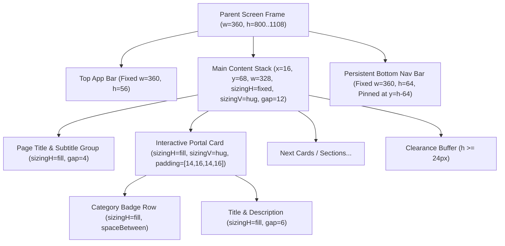
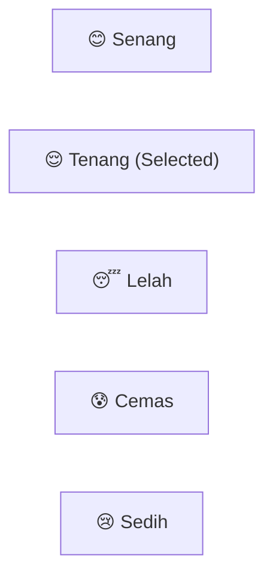
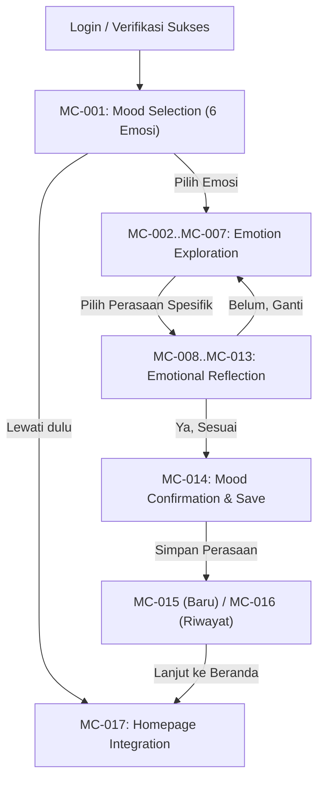

# DESIGN SYSTEM DOCUMENTATION: TEMAN SEBAYA
## Panduan Komprehensif Arsitektur Antarmuka, Token Desain, Komponen, dan Interaksi UI/UX

> **Status Dokumen**: 🟢 **Resmi & Otoritatif (Canonical Design System)**  
> **Versi**: 1.0.0 (Hasil Audit Menyeluruh 29 Layar Aktif)  
> **Lokasi File**: `design_system.md` (Root Project)  
> **Platform Target**: Mobile Android-First (Dimensi Baseline Kanvas: 360 × 800 px)  
> **Tool Desain**: FigCraft Desktop Engine via MCP / CLI (Live Port 7979)  
> **File Kanvas Utama**: [`teman-sebaya.figcraft`](file:///c:/Users/Fhazar/Fhazar_Workspace/02_PROJECTS/teman-sebaya/teman-sebaya.figcraft)  
> **Dokumen Pendamping**: [`REFERENCE_DESIGN_GUIDELINES.md`](file:///c:/Users/Fhazar/Fhazar_Workspace/02_PROJECTS/teman-sebaya/REFERENCE_DESIGN_GUIDELINES.md) & [`AGENTS.md`](file:///c:/Users/Fhazar/Fhazar_Workspace/02_PROJECTS/teman-sebaya/AGENTS.md)

---

## DAFTAR ISI

1. [Prinsip Desain Utama (Core Design Principles)](#1-prinsip-desain-utama-core-design-principles)
2. [Sistem Warna & Design Tokens](#2-sistem-warna--design-tokens)
3. [Sistem Tipografi](#3-sistem-tipografi)
4. [Sistem Spacing, Grid & Layout](#4-sistem-spacing-grid--layout)
5. [Aturan Auto Layout & Resizing](#5-aturan-auto-layout--resizing)
6. [Sistem Ikonografi (Lucide SVG Native)](#6-sistem-ikonografi-lucide-svg-native)
7. [Katalog Komponen UI Terstandarisasi](#7-katalog-komponen-ui-terstandarisasi)
8. [Standar State Komponen & Interaksi](#8-standar-state-komponen--interaksi)
9. [Pola Desain Spesifik Fitur Aplikasi](#9-pola-desain-spesifik-fitur-aplikasi)
10. [Panduan Aksesibilitas (a11y) & Keterbacaan](#10-panduan-aksesibilitas-a11y--keterbacaan)
11. [Panduan UX Writing & Nada Suara (Voice & Tone)](#11-panduan-ux-writing--nada-suara-voice--tone)
12. [Integrasi Referensi Desain Visual](#12-integrasi-referensi-desain-visual)
13. [Tata Kelola & Taksonomi Status Token](#13-tata-kelola--taksonomi-status-token)
14. [Struktur File & Pemeliharaan Desain](#14-struktur-file--pemeliharaan-desain)
15. [Ringkasan Audit & Rekomendasi Standardisasi](#15-ringkasan-audit--rekomendasi-standardisasi)

---

## 1. PRINSIP DESAIN UTAMA (CORE DESIGN PRINCIPLES)

Aplikasi **Teman Sebaya** dirancang sebagai ruang aman digital (*safe digital haven*) bagi remaja Indonesia untuk mencurahkan perasaan, memahami kesehatan mental dan reproduksi, membangun kebiasaan positif, dan mengakses bantuan profesional tanpa stigma. Seluruh keputusan desain UI/UX wajib berpijak pada prinsip-prinsip berikut:

### 1.1. Menenangkan & Regulatif (Calm & Emotionally Regulating)
- Mengutamakan warna netral monokromatik berbasis slate (`#0F172A` hingga `#F8FAFC`) untuk mengurangi beban kognitif (*cognitive load*) dan kelelahan visual (*visual fatigue*).
- Menghindari saturasi warna agresif, animasi mencolok, atau elemen yang memicu kepanikan, khususnya bagi remaja yang sedang berada dalam kondisi stres, cemas, atau depresi.

### 1.2. Empatik & Hangat Tanpa Menggurui (Empathetic & Non-Judgmental)
- Antarmuka menyambut pengguna seperti teman sebaya yang suportif dan dapat dipercaya, bukan sebagai otoritas kaku atau instruktur medis formal.
- Bahasa, label tombol, dan teks instruksi menggunakan kosakata bahasa Indonesia yang santun, akrab, inklusif, dan bebas stigma sosial.

### 1.3. Jelas & Transparan (Clear & Honest AI Transparency)
- Pengguna berhak mengetahui batas kemampuan teknologi. Asisten AI percakapan (`Teman Cerita`) secara transparan menyatakan identitasnya sebagai kecerdasan buatan, bukan psikolog atau tenaga medis berlisensi.
- Tidak pernah menyamarkan bot AI sebagai manusia nyata. Peringatan privasi disajikan di posisi teratas ruang obrolan sebelum percakapan dimulai.

### 1.4. Aman & Siap Krisis (Safety-First & Crisis Ready)
- Tombol eskalasi krisis (`Darurat`) dapat diakses secara langsung (1-tap access) dari header percakapan kapan saja tanpa memerlukan scroll.
- Dialog dan kartu bantuan darurat menyajikan nomor hotline resmi nasional (119 Hotline Kemenkes, 110 Kepolisian) dan alur bantuan nyata Puskesmas/BPJS yang dapat dihubungi langsung.

### 1.5. Fungsional & Efisien (Direct & Functional Wireframing)
- Setiap frame memiliki satu fungsi utama yang tegas. Komponen Auto Layout menjaga keseimbangan visual antara kepadatan informasi dan ruang bernapas (*white space*).
- Menolak dekorasi visual tanpa fungsi. Semua ikon, tombol, dan teks memiliki tujuan hierarkis yang jelas.

---

## 2. SISTEM WARNA & DESIGN TOKENS

Sistem warna aplikasi Teman Sebaya menggunakan palet monokromatik modern berbasis **Tailwind Slate** yang dipadukan dengan aksen fungsional semantik (Success Green & Crisis Red). Setiap warna telah diverifikasi langsung dari kanvas project `teman-sebaya.figcraft`.

### 2.1. Brand & Neutral Tokens

| Token Name | Hex Code | Status | Peran & Penggunaan Utama | Kontras (WCAG) |
| :--- | :--- | :--- | :--- | :--- |
| `color-brand-primary` | `#0F172A` | `Standardized` | Teks judul utama (H1, H2, H3), logo aplikasi, border aktif, background tombol primary selected, icon tab aktif. | 16.1:1 (on White) |
| `color-brand-surface-dark` | `#1E293B` | `Standardized` | Background tombol primary default, background mood selector terpilih, background header splash, kontras elevasi tinggi. | 13.9:1 (on White) |
| `color-text-subhead` | `#334155` | `Standardized` | Label form input, badge teks gelap, teks subjudul modul, teks kategori card. | 9.6:1 (on White) |
| `color-text-body` | `#475569` | `Standardized` | Teks paragraf, deskripsi kartu konten, teks bantuan sekunder, body copy umum. | 6.5:1 (on White) |
| `color-text-muted` | `#64748B` | `Standardized` | Ikon tab tidak aktif, meta timestamp, catatan copyright/footer, breadcrumbs non-aktif. | 4.6:1 (on White) |
| `color-border-muted` | `#94A3B8` | `Standardized` | Placeholder form input, icon chevron sekunder, border tombol outline netral. | 2.5:1 (UI Stroke) |
| `color-border-default` | `#CBD5E1` | `Standardized` | Border kartu konten standard (1px inside), border input box, divider bar horizontal, outline dialog modal. | 1.6:1 (UI Stroke) |
| `color-border-subtle` | `#E2E8F0` | `Standardized` | Garis pembatas header bawah persistent (1px), background lingkaran avatar, pembatas section ringan. | 1.2:1 (Decorative) |
| `color-surface-subtle` | `#F1F5F9` | `Standardized` | Background tombol sekunder, pill filter kategori non-aktif, tombol kembali (back button), badge kategori konten. | 1.1:1 (Surface) |
| `color-surface-card` | `#F8FAFC` | `Standardized` | Background kartu sekunder, mood logger container, surface tab bottom-nav aktif, background bubble chat AI. | 1.05:1 (Surface) |
| `color-surface-canvas` | `#FFFFFF` | `Standardized` | Background utama kanvas layar (canvas), background kartu interaktif putih, teks tombol primary. | Baseline |
| `color-overlay-scrim` | `#000000` | `Standardized` | Overlay modal dialog (opacity 40% - 60% simulasi scrim). | N/A |

### 2.2. Semantic Feedback & Success Tokens

| Token Name | Hex Code | Status | Peran & Penggunaan Utama |
| :--- | :--- | :--- | :--- |
| `color-success-text` | `#15803D` | `Standardized` | Teks judul konfirmasi sukses, feedback catatan mood tersimpan, badge skor sempurna kuis (3/3). |
| `color-success-body` | `#166534` | `Standardized` | Teks penjelasan detail konfirmasi sukses, afirmasi positif pada feedback card. |
| `color-success-indicator` | `#10B981` | `Standardized` | Titik status online asisten AI (`• Asisten AI · Online`), checklist progres kebiasaan selesai. |
| `color-success-border` | `#86EFAC` | `Standardized` | Border stroke kartu feedback mood berhasil disimpan (1px), border banner skor kuis berhasil. |
| `color-success-surface` | `#F0FDF4` | `Standardized` | Background kartu feedback sukses, background banner pengingat kebiasaan terselesaikan. |

### 2.3. Semantic Crisis & Danger Tokens

| Token Name | Hex Code | Status | Peran & Penggunaan Utama |
| :--- | :--- | :--- | :--- |
| `color-danger-primary` | `#DC2626` | `Standardized` | Teks tombol bahaya (Logout / Darurat), ikon peringatan krisis, border badge darurat aktif. |
| `color-danger-heading` | `#991B1B` | `Standardized` | Judul kartu rujukan krisis darurat, heading eskalasi bantuan psikologis segera. |
| `color-danger-body` | `#7F1D1D` | `Standardized` | Teks penjelasan hotline krisis 24 jam dan protokol keselamatan diri. |
| `color-danger-border` | `#EF4444` | `Standardized` | Border pill tombol darurat krisis di header obrolan (1px), border tombol bahaya dialog logout. |
| `color-danger-border-subtle` | `#FCA5A5` | `Standardized` | Border kartu edukasi pencegahan krisis, outline kartu nomor darurat sekunder. |
| `color-danger-surface-subtle` | `#FEE2E2` | `Standardized` | Background badge darurat intensitas sedang, background input dalam status error validasi. |
| `color-danger-surface` | `#FEF2F2` | `Standardized` | Background tombol aksi darurat, background banner dialog eskalasi bantuan segera. |

### 2.4. Specialty Tokens

| Token Name | Hex Code | Status | Peran & Penggunaan Utama |
| :--- | :--- | :--- | :--- |
| `color-accent-shield` | `#38BDF8` | `Existing` | Ikon pelindung privasi pada banner splash screen (Sky 400). |
| `color-guest-action` | `#1E293B` | `Deprecated` | Tombol 'Lanjut sebagai Tamu' pada onboarding/login lawas (telah dihapus demi privasi & otentikasi aman). |

---

## 3. SISTEM TIPOGRAFI

Tipografi Teman Sebaya dibangun menggunakan typeface keluarga **Inter** (sans-serif netral) dengan keterbacaan tinggi (*high legibility*) pada layar resolusi smartphone.

### 3.1. Hierarchy & Type Scale

| Tingkat Hierarki | Token Nama | Ukuran (Font Size) | Bobot (Weight) | Leading / Perilaku | Warna Default | Penerapan |
| :--- | :--- | :--- | :--- | :--- | :--- | :--- |
| **Display Brand** | `type-display` | `26 px` | Bold (700) | Single-line / Center | `#FFFFFF` / `#0F172A` | Splash screen title ("TEMAN SEBAYA"), Onboarding primary slogan. |
| **Page Title** | `type-h1` | `18 px` | Bold (700) | Wrapping `328 px` | `#0F172A` | Judul utama layar ("Halo, Sobat Sebaya!", "Teman Cerita", "Daftar Akun Baru"). |
| **Section Title** | `type-h2` | `16 px` | Bold (700) | Wrapping `328 px` | `#0F172A` | Sub-judul bagian utama, judul kartu tantangan besar. |
| **Header Title / Action** | `type-h3` | `14–15 px` | Bold (700) | Single-line / Fixed | `#0F172A` | Judul pada top app bar persistent (56px), judul sub-page back bar. |
| **Card Heading** | `type-subhead` | `13–13.5 px`| Bold (700) | Wrapping `296 px` | `#0F172A` | Judul modul dalam portal card ("Teman Cerita", "Teman Belajar", "Teman Akses"). |
| **Body Regular** | `type-body` | `12 px` | Regular (400) | Wrapping `296 px` | `#475569` | Paragraf deskripsi kartu modul, teks bacaan edukasi, pesan chat pengguna. |
| **Form Input Text** | `type-input` | `12 px` | Regular (400) | Single-line / Hug | `#0F172A` / `#94A3B8` | Nilai teks input yang diketikkan pengguna atau placeholder netral. |
| **Button Label** | `type-button` | `12 px` | Medium (500) / Bold | Single-line / Center | `#FFFFFF` / `#0F172A` | Label tombol aksi utama (44px height), tombol submit form. |
| **Input Label** | `type-label` | `11 px` | Medium (500) | Single-line | `#334155` | Label penjelas di atas form input field ("Alamat Email", "Kata Sandi"). |
| **Badge / Tag** | `type-badge` | `10–10.5 px`| Medium (500) | Single-line / Hug | `#0F172A` / `#334155` | Kategori modul ("Asisten AI Percakapan", "Psikoedukasi Terstruktur"). |
| **Micro / Helper** | `type-micro` | `10 px` | Regular (400) | Wrapping `296–328 px` | `#64748B` | Helper text validasi, status online asisten, timestamp chat. |
| **Nav Label** | `type-nav` | `9.5–10.5 px`| Regular (400) / Bold | Single-line / Center | `#0F172A` / `#64748B` | Label teks pada 5 item bottom navigation bar. |

### 3.2. Aturan Wajib Text Wrapping di FigCraft
1. **Lebar Kanvas Layar (Full Screen Width)**: Setiap blok teks multi-baris yang menempel langsung pada layar wajib memiliki parameter `width: 328` ($360 - 2 \times 16$).
2. **Di Dalam Kartu Ber-padding (Card Contained)**: Setiap teks deskripsi di dalam kartu yang memiliki padding horizontal 16px wajib memiliki parameter `width: 296` ($328 - 2 \times 16$).
3. **Dilarang Teks Melebar Tanpa Batas**: FigCraft me-render text node tanpa `width` sebagai single-line tak terbatas (*unbounded horizontal text*). Semua node paragraf wajib memiliki `width` eksplisit agar auto wrapping berjalan sempurna.

---

## 4. SISTEM SPACING, GRID & LAYOUT

Aplikasi Teman Sebaya menggunakan **Sistem Grid 8pt** dengan sub-grid presisi **4pt** untuk komponen mikro.

### 4.1. Skala Spacing Standar

| Nilai Spacing | Token Nama | Kategori | Penerapan Khusus |
| :--- | :--- | :--- | :--- |
| `2 px` | `space-2` | Micro | Indikator aktif bottom nav bar, garis aksen mikro. |
| `4 px` | `space-4` | Compact | Jarak antar icon & teks badge, gap indikator stepper halaman. |
| `6 px` | `space-6` | Tight | Gap vertikal antara judul kartu dan deskripsi, gap label input ke field box. |
| `8 px` | `space-8` | Base-1 | Gap tombol horizontal, gap antar tombol pilihan mood, gap icon tombol. |
| `10 px` | `space-10` | Base-1.25 | Padding vertikal tombol standar (44px), padding vertikal input field. |
| `12 px` | `space-12` | Base-1.5 | Gap vertikal standar dalam `Main Content Stack`, internal padding kartu kompak. |
| `14 px` | `space-14` | Intermediate | Padding vertikal kartu modul interaktif (`padding: [14, 16, 14, 16]`). |
| `16 px` | `space-16` | Base-2 (Standard) | Margin luar layar kiri & kanan (`offset: 16`), padding horizontal kartu modul. |
| `20 px` | `space-20` | Section | Padding internal dialog modal konfirmasi, safe margin atas section baru. |
| `24 px` | `space-24` | Buffer | Buffer pemisah aman antara konten terakhir sebelum bottom navigation bar. |
| `32 px` | `space-32` | Safe Area | Padding bawah pada layar tanpa bottom nav (layar auth & verifikasi). |

### 4.2. Spesifikasi Viewport & Native Grid
- **Lebar Layar (Fixed Width)**: `360 px` (Standar Android Mobile Handset).
- **Tinggi Layar (Variable Content Height)**:
  - Layar Default (Auth, Onboarding, Dialog, Chat): `800 px`
  - Layar Teman Belajar (Default Module): `840 px`
  - Layar Teman Akses (Filter Profesional): `860 px`
  - Layar Teman Akses (Jalur Bantuan Lengkap): `960 px`
  - Layar Beranda (Default Home): `1032 px`
  - Layar Beranda (Mood Tercatat & Feedback Banner): `1108 px`
- **Native Column Grid (Aktif di setiap frame)**:
  - `kind`: `columns`
  - `count`: `4`
  - `offset`: `16 px` (margin tepi kiri dan kanan)
  - `gutter`: `16 px` (jarak antar kolom)
  - `align`: `stretch`
- **Lebar Area Kerja Efektif Konten**: `328 px`.

---

## 5. ATURAN AUTO LAYOUT & RESIZING

Seluruh struktur tampilan Teman Sebaya diwajibkan menggunakan hierarki container Auto Layout murni untuk menjamin konsistensi, fleksibilitas terhadap perubahan teks, dan pemeliharaan desain yang bersih.

### 5.1. Struktur Hirarki Frame Standar



### 5.2. Prinsip Resizing (Hug vs Fill vs Fixed)

1. **Parent Screen Frame**: Selalu memiliki dimensi eksplisit (`width: 360`, `height: 800..1108`, `clip: true`).
2. **Header Persistent & Bottom Nav**:
   - `width`: `360` (`sizingH: 'fixed'`).
   - `height`: `56 px` (header) atau `64 px` (bottom nav) (`sizingV: 'fixed'`).
3. **Main Content Stack**:
   - `width`: `328` (`sizingH: 'fixed'`).
   - `height`: Otomatis mengikuti total volume isi (`sizingV: 'hug'`).
   - `gap`: `12 px` atau `14 px`.
4. **Card / Container Anak di Dalam Stack**:
   - `sizingH`: `'fill'` (secara otomatis membentang selebar `328 px`).
   - `sizingV`: `'hug'` (tinggi kartu menyesuaikan teks judul, deskripsi, dan tombol di dalamnya).
   - `padding`: Standar `[14, 16, 14, 16]`.
5. **Tombol (Button)**:
   - Full-width button: `width: 328` (`sizingH: 'fixed'`), `height: 44` (`sizingV: 'fixed'`).
   - Compact button / Badge: `sizingH: 'hug'`, `sizingV: 'fixed'` (tinggi `22 px` untuk badge, `28 px` untuk skip pill).

### 5.3. Hierarki Sudut Membulat (Corner Radius Hierarchy)

| Nilai Radius | Token | Penerapan Komponen |
| :--- | :--- | :--- |
| `1.5 px` | `radius-xs` | Garis indikator aktif pada bottom navigation item. |
| `4 px` | `radius-sm` | Kotak centang (*checkbox*), pill indikator mikro. |
| `6 px` | `radius-md` | Kategori status badge, tag psikoedukasi, pill pengubah bahasa (`ID | EN`). |
| `8 px` | `radius-lg` | Tombol utama (primary/secondary/outline), input field box, kartu modul portal, kartu feedback mood, tombol back bar. |
| `12 px` | `radius-xl` | Dialog modal popup, kartu krisis darurat besar. |
| `14–15 px` | `radius-2xl` | Pill tombol darurat krisis di header (`h=30px`), tombol 'Lewati' onboarding (`h=28px`). |
| `50% (Circle)` | `radius-full`| Avatar profil (`30x30`), avatar obrolan asisten (`32x32`), tombol FAB kirim pesan. |

---

## 6. SISTEM IKONOGRAFI (LUCIDE SVG NATIVE)

Aplikasi Teman Sebaya menggunakan ikon native **Lucide SVG Icons** dengan format vektor matematis (path SVG 24 × 24), ketebalan garis standar `strokeWeight: 2.0`, sudut membulat, dan tanpa isian (`fill: null`).

### 6.1. Matriks Ukuran Ikon

| Ukuran Ikon | Stroke Weight | Konteks Penerapan |
| :--- | :--- | :--- |
| `12 px` | `2.0 px` | Ikon internal pada status badge (`alertTriangle`, `check`). |
| `13 px` | `1.8 px` | Ikon bola dunia pada pemilih bahasa persistent header (`globe`). |
| `16 px` | `2.0 px` | Ikon tombol aksi (leading icon tombol, ikon panah kembali `arrowLeft`, ikon avatar header `user`). |
| `18 px` | `2.0 px` | Ikon input form (toggle password `eye`), ikon chevron card. |
| `20 px` | `1.8 / 2.2 px`| Ikon 5 menu navigasi utama pada bottom nav bar (`home`, `messageCircle`, `bookOpen`, `sprout`, `compass`). |
| `24 px` | `2.0 px` | Ikon ilustrasi fitur pada kartu informasi besar. |
| `32 px` | `2.0 px` | Ikon modal dialog konfirmasi keluar (`logOut`) atau bantuan darurat. |

### 6.2. Registri Ikon Vektor Aktif

Seluruh ikon berikut tersedia secara terpusat dalam objek `ICONS` pada generator script aplikasi:

| Nama Ikon | Preview Path SVG (Ringkas) | Penggunaan Spesifik dalam Modul |
| :--- | :--- | :--- |
| `home` | `M3 9l9-7 9 7v11a2 2 0 0 1-2 2H5...` | Menu 1 Bottom Navigation: **Beranda**. |
| `messageCircle` | `M21 11.5a8.38 8.38 0 0 1-.9 3.8...` | Menu 2 Bottom Navigation & Avatar Asisten: **Teman Cerita**. |
| `bookOpen` | `M2 3h6a4 4 0 0 1 4 4v14a3 3 0 0 0...` | Menu 3 Bottom Navigation: **Teman Belajar**. |
| `sprout` | `M7 20h10 M10 20c0-4.4 3.6-8 8-8...` | Menu 4 Bottom Navigation: **Teman Tumbuh**. |
| `compass` | `M12 22a10 10 0 1 0 0-20 10...` | Menu 5 Bottom Navigation: **Teman Akses**. |
| `user` | `M20 21v-2a4 4 0 0 0-4-4H8...` | Tombol navigasi profil pengguna pada Persistent Global Header. |
| `globe` | `M12 2a10 10 0 1 0 0 20 10...` | Pill tombol ganti bahasa `[ID | EN]` pada Persistent Global Header. |
| `alertTriangle` | `M10.29 3.86L1.82 18a2 2 0 0 0 1.71...` | Tombol 'Darurat' di header obrolan, kartu peringatan krisis darurat. |
| `checkCircle` | `M22 11.08V12a10 10 0 1 1-5.93...` | Status verifikasi berhasil, feedback tersimpan, skor kuis sempurna. |
| `check` | `M20 6L9 17l-5-5` | Checklist kebiasaan harian, indikator pilihan checklist kuis. |
| `arrowLeft` | `M19 12H5 M12 19l-7-7 7-7` | Tombol navigasi kembali (*Back Button*) pada seluruh sub-page bar. |
| `arrowRight` | `M5 12h14 M12 5l7 7-7 7` | Tombol navigasi maju pada Onboarding & tombol 'Mulai Sekarang'. |
| `chevronRight` | `M9 18l6-6-6-6` | Indikator affordance kartu interaktif modul portal di Beranda. |
| `send` | `M22 2L11 13 M22 2l-7 20-4-9...` | Tombol kirim pesan (*Send Action*) pada form obrolan Teman Cerita. |
| `eye` | `M1 12s4-8 11-8 11 8 11 8...` | Tombol periksa/tampilkan kata sandi (*Password Visibility Toggle*). |
| `phone` | `M22 16.92v3a2 2 0 0 1-2.18...` | Tombol panggil hotline darurat 119 dan kontak konselor sebaya. |
| `logOut` | `M9 21H5a2 2 0 0 1-2-2V5...` | Ikon pada kartu modal konfirmasi keluar akun (*Logout Dialog*). |
| `shield` | `M12 22s8-4 8-10V5l-8-3...` | Ikon privasi AI obrolan dan badge perlindungan kerahasiaan data. |
| `heart` | `M20.84 4.61a5.5 5.5 0 0 0...` | Ikon modul kesehatan mental dan relasi sehat Teman Belajar. |
| `lock` | `M7 11V7a5 5 0 0 1 10 0v4...` | Ikon keamanan kata sandi baru dan enkripsi data obrolan. |
| `key` | `M21 2l-2 2m-1.5 1.5L16 7...` | Ikon verifikasi kode OTP dan pemulihan akun lupa password. |
| `search` | `M11 19a8 8 0 1 0 0-16 8...` | Ikon pencarian fasilitas kesehatan dan tenaga ahli di Teman Akses. |
| `info` | `M12 16v-4 M12 8h.01 M12 22...` | Ikon informasi disclaimer bantuan profesional dan rujukan BPJS. |

---

## 7. KATALOG KOMPONEN UI TERSTANDARISASI

Seluruh komponen berikut dirancang modular, beroperasi menggunakan Auto Layout native FigCraft, dan siap diimplementasikan ulang.

### 7.1. Header & Navigation Components

#### A. Global Persistent Header (`drawGlobalPersistentHeaderAL`)
- **Tinggi**: `56 px`, **Lebar**: `360 px` (Fixed).
- **Auto Layout**: `layout: 'horizontal'`, `padding: [12, 16, 12, 16]`, `mainAlign: 'spaceBetween'`, `crossAlign: 'center'`.
- **Elemen Kiri**: Teks brand `"TEMAN SEBAYA"` (Font 15px, Bold, `#0F172A`).
- **Elemen Kanan (Horizontal AL Container, gap: 8px)**:
  1. *Language Switcher Pill*: Background `#F1F5F9`, border `#CBD5E1`, radius 6px, padding `[4, 8, 4, 8]`, icon `globe` 13px, teks `"ID | EN"` 10.5px Medium `#475569`.
  2. *Profile Avatar Button*: Diameter 30px, radius 15px, background `#E2E8F0`, icon `user` 16px `#0F172A`. Terhubung secara interaktif ke layar Profil Pengguna (`SCR-012`).

#### B. Sub-Page Back Bar (`drawSubPageBackBarAL`)
- **Tinggi**: `56 px`, **Lebar**: `360 px` (Fixed).
- **Auto Layout**: `layout: 'horizontal'`, `padding: [12, 16, 12, 16]`, `gap: 12`, `crossAlign: 'center'`.
- **Elemen**:
  1. *Back Button Container*: 34 × 32 px, radius 8px, background `#F1F5F9`, border `#CBD5E1`, icon `arrowLeft` 16px `#0F172A`. Terhubung ke frame tujuan sebelumnya.
  2. *Page Title Text*: Font 15px, Bold, `#0F172A`.

#### C. Dedicated Chat Top App Bar (`drawChatTopAppBarAL`)
- **Tinggi**: `56 px`, **Lebar**: `360 px` (Fixed).
- **Auto Layout**: `layout: 'horizontal'`, `padding: [12, 12, 12, 12]`, `mainAlign: 'spaceBetween'`, `crossAlign: 'center'`.
- **Kelompok Kiri**:
  - Tombol kembali (32 × 32 px, radius 8px).
  - Avatar lingkaran asisten (32 × 32 px, background `#F1F5F9`, icon `messageCircle` 16px).
  - Kolom nama & status: `"Teman Cerita"` (12.5px Bold `#0F172A`) dan `"• Asisten AI · Online"` (10px Medium `#10B981`).
- **Kelompok Kanan**:
  - *Emergency Crisis Action Pill*: Tinggi 30px, radius 15px, background `#FEF2F2`, border 1px `#EF4444`, padding `[4, 10, 4, 10]`, icon `alertTriangle` 12px `#DC2626`, teks `"Darurat"` 11px Bold `#DC2626`. Terhubung ke Dialog Bantuan Darurat (`SCR-007-C`).

#### D. Bottom Navigation Bar (`drawBottomNavAL`)
- **Tinggi**: `64 px`, **Lebar**: `360 px` (Fixed, diposisikan di dasar layar $y = h - 64$).
- **Auto Layout**: `layout: 'horizontal'`, `mainAlign: 'spaceBetween'`, `crossAlign: 'center'`, background `#FFFFFF`, border-top `#CBD5E1`.
- **5 Item Navigasi (Lebar masing-masing 72px)**:
  1. `Beranda` (`icon: 'home'`) -> Terhubung ke `SCR-006`.
  2. `Cerita` (`icon: 'messageCircle'`) -> Terhubung ke `SCR-007`.
  3. `Belajar` (`icon: 'bookOpen'`) -> Terhubung ke `SCR-008`.
  4. `Tumbuh` (`icon: 'sprout'`) -> Terhubung ke `SCR-009`.
  5. `Akses` (`icon: 'compass'`) -> Terhubung ke `SCR-011`.
- **Indikator Aktif**: Item aktif memiliki garis indikator atas 28 × 3 px warna `#0F172A`, icon 20px `#0F172A` (stroke 2.2), teks 10.5px Bold `#0F172A`, dan surface `#F8FAFC`. Item tidak aktif menggunakan warna `#64748B`.

---

### 7.2. Button Components (`drawButtonAL`)

Standar tinggi tombol aplikasi adalah **`44 px`** untuk memenuhi target sentuh minimum Android (48dp / 44px).

| Varian Tombol | Background Fill | Stroke Border | Warna Teks | Bobot Teks | Penggunaan Spesifik |
| :--- | :--- | :--- | :--- | :--- | :--- |
| **Primary** | `#1E293B` | `null` | `#FFFFFF` | Medium (500) | Aksi utama halaman ("Masuk", "Mulai Konseling", "Kirim Kode"). |
| **Secondary** | `#F1F5F9` | `#CBD5E1` (1px) | `#0F172A` | Medium (500) | Aksi alternatif terstruktur, opsi pilihan relaksasi. |
| **Outline** | `#FFFFFF` | `#94A3B8` (1px) | `#0F172A` | Medium (500) | Tombol sekunder berdampingan ("Batal", "Ulangi Kuis"). |
| **Ghost** | `#FFFFFF` | `null` | `#475569` | Medium (500) | Tombol tersier ("Lupa Kata Sandi?", "Lewati"). |
| **Danger** | `#FEF2F2` | `#EF4444` (1px) | `#DC2626` | Bold (700) | Aksi kritis berisiko ("Keluar Akun", "Hubungi 119 Sekarang"). |

- **Aturan Tata Letak Ikon Tombol**:
  - *Leading Icon*: Ditampilkan di sebelah kiri teks dengan gap 8px (misal: icon telepon pada panggilan darurat).
  - *Trailing Icon pada Tombol Lebar ($\ge 280\text{ px}$)*: Menggunakan `mainAlign: 'spaceBetween'` dengan padding `[10, 16, 10, 16]` sehingga icon chevron berada di ujung kanan.
  - *Tombol Standar Tanpa Trailing Icon*: Selalu menggunakan `mainAlign: 'center'`.

---

### 7.3. Form Controls & Inputs (`drawInputAL`)

- **Container Input**: Auto Layout vertikal, gap 6px, lebar 328px (`sizingH: 'fixed'`).
- **Label Input**: Font 11px, Medium, `#334155`.
- **Field Box**:
  - Tinggi: `42 px`, Lebar: `328 px` (`sizingH: 'fill'`).
  - Auto Layout: `layout: 'horizontal'`, `padding: [10, 12, 10, 12]`, `mainAlign: 'spaceBetween'`, `crossAlign: 'center'`.
  - Surface: `#FFFFFF`, Border: `1px solid #CBD5E1`, Radius: `8 px`.
  - Placeholder Text: Font 12px, Regular, `#94A3B8`.
  - Password Toggle Icon: Ikon `eye` 18px `#94A3B8` di sisi kanan field box.

---

### 7.4. Badges & Status Tags (`drawBadgeAL`)

- **Tinggi**: `22 px`, Lebar: Otomatis (`sizingH: 'hug'`).
- **Auto Layout**: `layout: 'horizontal'`, `padding: [3, 8, 3, 8]`, `gap: 5`, `mainAlign: 'center'`, `crossAlign: 'center'`.
- **Radius**: `6 px`.
- **Kombinasi Warna**:
  - *Default Tag*: Fill `#F1F5F9`, Teks 10px Medium `#0F172A`.
  - *Success Tag*: Fill `#F0FDF4`, Teks 10px Bold `#15803D`, Icon `checkCircle` 12px.
  - *Crisis Tag*: Fill `#FEF2F2`, Teks 10px Bold `#DC2626`, Icon `alertTriangle` 12px.

---

### 7.5. Containers & Interactive Cards

#### A. Interactive Portal Card (Kartu Modul Beranda)
- **Dimensi**: Lebar 328px, Tinggi mengikuti konten (`sizingV: 'hug'`).
- **Surface**: Fill `#FFFFFF`, Border `1px solid #CBD5E1`, Radius `8 px`.
- **Padding**: `[14, 16, 14, 16]`.
- **Hierarki Internal**:
  1. *Top Row*: Badge kategori modul (misal: `"Asisten AI Percakapan"`), di sisi kanan terdapat icon `chevronRight` 20px `#94A3B8`.
  2. *Heading*: Judul modul (misal: `"Teman Cerita"`), Font 14px Bold `#0F172A`.
  3. *Description*: Deskripsi layanan (misal: `"Curahkan perasaanmu kapan saja dengan asisten AI..."`), Font 12px Regular `#475569`, wajib text-wrapping `296 px`.

#### B. Notice / Information Card
- **Surface**: Fill `#F8FAFC`, Border `1px solid #CBD5E1`, Radius `8 px`, Padding `[12, 14, 12, 14]`.
- Digunakan untuk catatan panduan, pengingat privasi, atau informasi operasional.

#### C. Feedback Banner (Catatan Emosi Tersimpan)
- **Surface**: Fill `#F0FDF4`, Border `1px solid #86EFAC`, Radius `8 px`, Padding `[10, 14, 10, 14]`.
- **Heading Row**: Ikon `checkCircle` 16px `#15803D`, Teks `"Catatan Tersimpan: Tenang"` 12px Bold `#15803D`.
- **Body Copy**: `"Senang mendengarnya! Menjaga ketenangan pikiran adalah modal baik untuk beraktivitas hari ini."` (11.5px Regular `#166534`, text wrapping 296px).

#### D. Emergency Crisis Card
- **Surface**: Fill `#FEF2F2`, Border `1px solid #EF4444`, Radius `8 px`, Padding `[14, 16, 14, 16]`.
- **Heading**: Ikon `alertTriangle` 18px `#DC2626` berdampingan dengan Teks `"Bantuan Darurat Krisis"` 13px Bold `#991B1B`.
- **Isi**: Teks rujukan cepat hotline 119 dan nomor konseling darurat, dilengkapi tombol aksi langsung.

---

### 7.6. Selection Components (Mood Selector 5 Emosi)

Komponen pencatat emosi harian pada Beranda mengadopsi selektor 5 emosi diskret yang telah diuji dan divalidasi oleh pengguna:



- **Tata Letak Baris**:
  - Baris 1: 3 tombol mood horizontal (`Senang`, `Tenang`, `Lelah`), gap 8px.
  - Baris 2: 2 tombol mood horizontal (`Cemas`, `Sedih`), gap 8px.
- **State Default (Belum Dipilih)**:
  - Tinggi tombol: 34px, Radius: 8px.
  - Surface: `#FFFFFF`, Border: `1px solid #CBD5E1`.
  - Teks & Emoji: Font 12px Medium `#0F172A`.
- **State Selected (Terpilih)**:
  - Surface: `#1E293B`, Border: `1px solid #1E293B`.
  - Teks & Emoji: Font 12px Medium `#FFFFFF`.
  - Memicu transisi interaktif ke frame `Beranda - Mood Tercatat` (`SCR-006-B`).

---

### 7.7. Dialogs & Modals

- **Overlay Background (Scrim)**: Kanvas transparan hitam (simulasi `#000000` alpha).
- **Dialog Card Container**:
  - Lebar: `328 px`, Posisikan di tengah layar ($y \approx 260\text{ px}$).
  - Surface: Fill `#FFFFFF`, Border `1px solid #CBD5E1`, Radius `12 px`.
  - Auto Layout: `layout: 'vertical'`, `padding: [20, 20, 20, 20]`, `gap: 16`, `crossAlign: 'center'`.
- **Komponen Internal**:
  1. *Icon Container*: Diameter 48px, background `#FEF2F2`, icon `logOut` / `alertTriangle` 24px `#DC2626`.
  2. *Text Group*: Judul 16px Bold `#0F172A` dan deskripsi konfirmasi 12px Regular `#475569` (center-aligned).
  3. *Action Button Row*: Dua tombol horizontal (lebar masing-masing 136px, gap 12px):
     - Tombol Batal: Type Outline (`#FFFFFF`, stroke `#94A3B8`, text `#0F172A`).
     - Tombol Konfirmasi: Type Danger (`#FEF2F2`, stroke `#EF4444`, text `#DC2626`).

---

## 8. STANDAR STATE KOMPONEN & INTERAKSI

Aplikasi Teman Sebaya mendefinisikan standar visual yang konsisten untuk setiap kemungkinan state interaksi pengguna:

| State Komponen | Ciri Visual & Perubahan Properti | Konteks Penerapan |
| :--- | :--- | :--- |
| **Default** | Menggunakan token standard, border `#CBD5E1`, teks `#0F172A` atau `#475569`. | Tampilan awal sebelum ada interaksi. |
| **Hover / Focus** | Border menebal menjadi `1.5px solid #0F172A`, surface input berubah bersih. | Kursor desktop atau keyboard focus pada field input. |
| **Pressed / Active** | Scale transform 0.98, surface menjadi lebih gelap 5% (misal `#1E293B` $\rightarrow$ `#0F172A`). | Sesaat tombol atau kartu ditekan di layar sentuh. |
| **Selected** | Inversi warna kontras tinggi: background berubah menjadi `#1E293B`, teks berubah putih `#FFFFFF`. | Tombol mood selector aktif, tab filter aktif. |
| **Disabled** | Opacity container diturunkan ke `40%`, cursor `not-allowed`, event pointer non-aktif. | Tombol submit form sebelum seluruh input wajib diisi. |
| **Error / Invalid** | Border berubah menjadi `1px solid #EF4444`, muncul teks micro helper warna `#DC2626`. | Format email salah, password kurang dari 8 karakter. |
| **Loading** | Label tombol disembunyikan, digantikan spinner indikator progres putar netral. | Proses verifikasi OTP atau otentikasi akun. |

---

## 9. POLA DESAIN SPESIFIK FITUR APLIKASI

Aplikasi Teman Sebaya terdiri dari **29 Layar Independen** yang terorganisir ke dalam 7 zona fungsional utama:

### 9.1. Zona 1: Otentikasi & Onboarding (Auth Flow)
- **Splash Screen (`SCR-001`)**:
  - Mengadopsi komposisi terpusat optis (*Rocky-inspired optical center layout*, $y \approx 40\%$).
  - Judul brand `"TEMAN SEBAYA"` (Font 26px Bold, White, Tracking +1px).
  - Subtitel misi ramah remaja (Font 11px Regular, White, wrapping 280px).
  - Status bar atas (9:41, wifi, battery) dan pill tombol start di bagian bawah.
  - Banner perlindungan privasi data dengan ikon pelindung `shield` Sky 400.
- **Onboarding Stepper (`SCR-002`, `SCR-003`, `SCR-004`)**:
  - Header persistent dengan brand name dan tombol `'Lewati'` (Skip) di kanan atas.
  - Area ilustrasi konsep ber-padding seimbang, judul proposisi nilai 18px Bold.
  - Stepper indicator horizontal 3 titik di atas tombol aksi navigasi.
- **Login & Registrasi (`SCR-005`, `SCR-005-B`)**:
  - Form input dengan label jelas dan toggle password visibility.
  - Tombol aksi primary full-width 44px.
  - Menghilangkan opsi 'Masuk sebagai Tamu' yang telah didepresiasi demi menjaga privasi dan keutuhan riwayat curhat pengguna.
- **Verifikasi OTP & Reset Sandi (`SCR-005-C`, `SCR-005-D`, `SCR-005-E`, `SCR-005-F`, `SCR-005-G`)**:
  - 4 kotak input OTP terpisah, feedback visual kode terkirim via email/SMS.
  - Layar sukses verifikasi dengan ikon `checkCircle` besar dan tombol lanjut ke Beranda.

### 9.2. Zona 2: Beranda (Home Dashboard)
- **Beranda Default (`SCR-006`) & Mood Tercatat (`SCR-006-B`)**:
  - Salam pembuka bersahabat: `"Halo, Sobat Sebaya! / Bagaimana perasaanmu saat ini?"`.
  - Kartu Pencatat Emosi Harian dengan **5 Tombol Mood**: `😊 Senang`, `😌 Tenang`, `😴 Lelah`, `😰 Cemas`, `😢 Sedih`.
  - Pada varian Tercatat (`SCR-006-B`), tombol terpilih (`Tenang`) memiliki background dark `#1E293B`, dan di bawahnya muncul Feedback Banner hijau (`#F0FDF4`).
  - 5 Kartu Modul Portal Navigasi:
    1. `Teman Cerita` (Asisten AI Percakapan)
    2. `Teman Belajar` (Psikoedukasi Terstruktur)
    3. `Teman Tumbuh` (Aktivitas Mandiri & Tantangan Kebiasaan)
    4. `Teman Komunitas` (Dukungan Sebaya Binaan PIK-R)
    5. `Teman Akses` (Navigasi Bantuan Konselor & Krisis)
  - Footer penutup: Pernyataan ruang aman remaja.

### 9.3. Zona 3: Teman Cerita (AI Chatbot & Crisis Routing)
- **Top Bar Percakapan**:
  - Status online asisten kecerdasan buatan (`• Asisten AI · Online`).
  - Tombol Darurat merah krisis (`Darurat`) di kanan atas.
- **Banner Transparansi AI & Keamanan Privasi**:
  - Wajib tampil di atas chat: *"Percakapan ini diproses oleh AI. Jangan bagikan informasi pribadi yang sangat rahasia."*
- **Layar Percakapan (`SCR-007`, `SCR-007-CHAT`, `SCR-007-AKTIF`, `SCR-007-RELAKSASI`, `SCR-007-ESKALASI`)**:
  - Quick topic chips: `"Lagi merasa cemas dan gelisah"`, `"Kewalahan dengan tugas dan ekspektasi"`, `"Sedang ada masalah dengan teman"`, `"Hanya ingin menenangkan pikiran sejenak"`.
  - Chat Bubble Pengguna: Rata kanan, background `#1E293B`, teks putih `#FFFFFF`.
  - Chat Bubble AI: Rata kiri, background `#F8FAFC`, border `#CBD5E1`, teks `#0F172A`.
  - Modul Panduan Relaksasi Latihan Pernapasan 4-7-8 interaktif.
  - Modul Eskalasi Bantuan Manusia dengan rujukan ke konselor sebaya dan psikolog klinis.
- **Dialog Bantuan Darurat (`SCR-007-C`)**:
  - Modal darurat dengan tombol cepat panggil Hotline 119 dan 110.

### 9.4. Zona 4: Teman Belajar (Psychoeducation & Interactive Quiz)
- **Default Bacaan (`SCR-008`)**:
  - Modul edukasi kesehatan reproduksi, regulasi emosi, batasan pribadi (*personal boundaries*), dan relasi sehat.
  - Kartu kuis interaktif 3 pertanyaan untuk menguji pemahaman materi.
- **Hasil Kuis Skor Sempurna (`SCR-008-B` - Skor 3/3)**:
  - Banner hijau sukses, badge afirmasi pemahaman luar biasa.
- **Hasil Kuis Remedial (`SCR-008-C` - Skor 0/3)**:
  - Banner netral suportif tanpa mempermalukan pengguna, ajakan untuk membaca kembali ringkasan materi secara santai.

### 9.5. Zona 5: Teman Tumbuh (Habit Tracker & Growth Challenges)
- **Default Tracker (`SCR-009`)**:
  - Pengukur progres kebiasaan harian (minum air, istirahat cukup, jurnal syukur, jalan kaki santai).
  - Streak harian dan metrik pertumbuhan positif.
- **Layar Tantangan Kebiasaan (`SCR-009-B`)**:
  - Tantangan eksplorasi minat diri 7 hari dengan checklist harian.

### 9.6. Zona 6: Teman Komunitas (PIK-R Peer Support)
- **Komunitas Remaja Sebaya (`SCR-010`)**:
  - Ruang aman terhubung dengan kegiatan positif remaja binaan PIK-R (Pusat Informasi dan Konseling Remaja).
  - Aturan interaksi komunitas: bebas perundungan (*zero-bullying*), menjaga kerahasiaan teman, dan saling mendukung.

### 9.7. Zona 7: Teman Akses (Helpline Directory & Filters)
- **Jalur Bantuan Lengkap (`SCR-011`)**:
  - Direktori fasilitas kesehatan ramah remaja, Puskesmas terdekat, dan layanan rujukan BPJS Kesehatan.
- **Filter Profesional (`SCR-011-B`)**:
  - Tab filter cepat: `"Semua"`, `"Puskesmas"`, `"Psikolog BPJS"`, `"Hotline 24 Jam"`.
  - Kartu kontak profesional dengan jam operasional dan tombol panggil langsung.

### 9.8. Zona Khusus: Alur Lengkap Mood Check-in (Mood Check-in Flow — 17 Layar di Page 2)

Halaman-halaman berikut ditempatkan pada **Page "Mood Check-in Flow"** di dalam [`teman-sebaya.figcraft`](file:///c:/Users/Fhazar/Fhazar_Workspace/02_PROJECTS/teman-sebaya/teman-sebaya.figcraft) sebagai alur bertahap sebelum pengguna masuk ke Beranda:



* **Daftar 17 Layar Mandiri**:
  1. `MC-001` (Mood Selection): Grid 2x3 pilihan 6 emosi (Bahagia, Tenang, Marah, Lelah, Sedih, Cemas), tombol Lewati dulu.
  2. `MC-002` (Emotion - Bahagia): Eksplorasi 9 perasaan (Ceria, Puas, Tertarik, Bangga, Diterima, Berdaya, Damai, Percaya diri, Optimis).
  3. `MC-003` (Emotion - Tenang): Eksplorasi 8 perasaan (Damai, Lega, Nyaman, Aman, Fokus, Seimbang, Bersyukur, Santai).
  4. `MC-004` (Emotion - Marah): Eksplorasi 9 perasaan (Kesal, Jengkel, Frustrasi, Tersinggung, Kecewa, Geram, Tidak dihargai, Tidak adil, Ingin meluapkan).
  5. `MC-005` (Emotion - Lelah): Eksplorasi 8 perasaan (Lelah fisik, Lelah mental, Jenuh, Kewalahan, Kehabisan energi, Sulit fokus, Butuh istirahat, Ingin menyendiri).
  6. `MC-006` (Emotion - Sedih): Eksplorasi 8 perasaan (Kecewa, Kesepian, Kehilangan, Hampa, Rindu, Tidak dihargai, Terluka, Ingin didengar).
  7. `MC-007` (Emotion - Cemas): Eksplorasi 8 perasaan (Khawatir, Gugup, Takut, Tidak yakin, Gelisah, Tertekan, Overthinking, Takut gagal).
  8. `MC-008`..`MC-013` (Reflection Screens): Refleksi personal dengan kutipan afirmasi relevan, pertanyaan validasi *"Apakah kutipan ini menggambarkan perasaanmu?"*, tombol konfirmasi *"Ya, sesuai dengan perasaanku"* dan alternatif *"Belum, pilih perasaan lain"*.
  9. `MC-014` (Mood Confirmation): Ringkasan kategori, perasaan spesifik, kutipan terpilih, stempel tanggal, jaminan privasi, tombol Simpan Perasaan & Ubah Pilihan.
  10. `MC-015` (Mood Statistics - First Entry): State jujur pengguna pertama (1 catatan), pesan motivasi membangun kebiasaan, grafik belum terisi tanpa angka fiktif.
  11. `MC-016` (Mood Statistics - With History): Bar chart grayscale 6 emosi (periode 7 hari / 14 catatan), riwayat 3 hari terakhir, catatan refleksi diri.
  12. `MC-017` (Homepage Integration): Tampilan Beranda yang telah mengintegrasikan ringkasan mood hari ini, tombol Lihat Statistik & Perbarui Catatan, serta 5 modul portal aplikasi.

---

## 10. PANDUAN AKSESIBILITAS (A11Y) & KETERBACAAN

Untuk memastikan aplikasi inklusif bagi seluruh remaja dari berbagai latar belakang perangkat dan kemampuan fisik:

1. **Target Sentuh Minimum (Minimum Touch Target)**: Seluruh tombol, link navigasi, dan elemen interaktif wajib berukuran minimal **44 × 44 px** (atau memiliki padding virtual yang mencukupi batas sentuhan jari).
2. **Rasio Kontras Warna (WCAG 2.1 AA Compliant)**:
   - Teks Utama (`#0F172A`) di atas Kanvas Putih (`#FFFFFF`): Rasio Kontras **16.1:1** (Melampaui standar AAA).
   - Teks Body Deskripsi (`#475569`) di atas Kanvas Putih (`#FFFFFF`): Rasio Kontras **6.5:1** (Lolos standar AA).
   - Teks Krisis (`#DC2626`) di atas Background Krisis (`#FEF2F2`): Rasio Kontras **4.8:1** (Lolos standar AA).
3. **Keterbacaan Tipografi**:
   - Ukuran font terkecil untuk teks pembacaan umum adalah `11.5–12 px`. Font ukuran `10 px` hanya diperbolehkan untuk timestamp atau catatan hak cipta dekoratif.
   - Tidak diperkenankan menaruh teks berwarna abu-abu muda (`#94A3B8`) sebagai teks isi artikel karena menurunkan keterbacaan.
4. **Indikator Visual Non-Warna**:
   - Status perubahan (misal: sukses atau darurat) selalu didampingi oleh **ikon visual penjelas** (`checkCircle` untuk sukses, `alertTriangle` untuk bahaya), tidak pernah mengandalkan perubahan warna semata.

---

## 11. PANDUAN UX WRITING & NADA SUARA (VOICE & TONE)

### 11.1. Persona & Karakter Suara
- **Sapaan Resmi**: Menggunakan sapaan hangat `"Sobat Sebaya"` atau kata ganti santun `"kamu"`. Dilarang menggunakan sapaan kaku `"Anda"` atau slang gaul berlebihan yang cepat usang (*cringe*).
- **Nada Emosional**: Empatik, menenangkan, menerima apa adanya, dan bebas dari penghakiman (*unconditional positive regard*).
- **Transparansi Teknologi**: Jujur dan jelas. Selalu sebutkan *"Asisten AI Percakapan"* dan bukan mengklaim diri sebagai *"Dokter"* atau *"Psikolog Asli"*.

### 11.2. Kosakata & Larangan UX Writing (Anti-Pattern Removal)

| Dilarang Digunakan | Wajib Digunakan Sebagai Pengganti | Alasan / Panduan |
| :--- | :--- | :--- |
| `Demo / Preview / Simulasi` | Dihapus sepenuhnya dari kanvas | Menghilangkan kesan prototipe tidak siap pakai. |
| `Dummy Data / Placeholder Text` | Konten riil yang relevan dan edukatif | Memberikan pengalaman autentik bagi penguji dan pengguna. |
| `Lanjut sebagai Tamu (Guest Mode)` | `Masuk / Buat Akun Baru` | Menjamin kontinuitas catatan mood harian dan keamanan data. |
| `Anda Mengalami Gangguan Jiwa` | `Kamu sedang merasa cemas atau terbebani` | Menghindari label medis dan diagnosis mandiri (*self-diagnosis*). |
| `Chat dengan Dokter Spesialis` | `Curhat dengan Asisten AI Teman Cerita` | Menghindari kesalahan persepsi klinis hukum malpraktik. |
| `Error System 500 / Gagal Total` | `Koneksi terputus sejenak. Yuk coba lagi.` | Nada bersahabat yang menenangkan dan solutif. |

### 11.3. Penulisan Pesan Darurat & Rujukan Krisis
- Teks krisis wajib singkat, tegas, dan berorientasi tindakan cepat.
- Contoh copy standar:  
  *“Jika kamu merasa dalam bahaya atau membutuhkan pertolongan mendesak saat ini, kamu tidak sendirian. Silakan hubungi Hotline Darurat Kesehatan Jiwa 119 atau akses tombol Darurat di kanan atas.”*

---

## 12. INTEGRASI REFERENSI DESAIN VISUAL

Setiap kali pengguna memberikan referensi visual baru (Dribbble, Behance, screenshot aplikasi lain), agen AI wajib menerapkan aturan kerja berikut:

### 12.1. Aturan Emas Integrasi
> **"Use the reference for design direction, not as a replacement for the existing design system."**

1. **Yang Diadopsi dari Referensi**:
   - Arah susunan tata letak (layout spatial distribution).
   - Komposisi visual dan pengelompokan hierarki elemen.
   - Rasio proporsi ruang kosong (*visual balance* & *negative space*).
2. **Yang Wajib Dipertahankan 100% dari Design System**:
   - Palet warna (`#0F172A`, `#1E293B`, `#F8FAFC`, `#CBD5E1`, dll.).
   - Typeface `Inter` dan skala ukuran font resmi.
   - Komponen tombol native (`drawButtonAL`), persistent header, dan bottom nav.
   - Ikon vektor Lucide SVG native.
3. **Strict Scope Control**: Perubahan hanya boleh diaplikasikan pada layar target spesifik yang ditugaskan pengguna. Dilarang merombak layar lain secara sepihak.

---

## 13. TATA KELOLA & TAKSONOMI STATUS TOKEN

Untuk mencegah fragmentasi desain di masa mendatang, seluruh token dan komponen diklasifikasikan ke dalam 5 status taksonomi resmi:

| Status Token | Definisi & Ketentuan Operasional |
| :--- | :--- |
| **`Existing`** | Elemen atau token yang saat ini terpasang dan aktif di dalam file kanvas `teman-sebaya.figcraft`. |
| **`Standardized`** | Token yang telah diaudit, disetujui, dan memiliki nama variabel resmi dalam dokumentasi ini. Wajib menjadi pilihan utama dalam perancangan berikutnya. |
| **`Proposed`** | Token atau komponen baru yang sedang diajukan untuk mendukung fitur masa depan (misal: tema gelap, badge gamifikasi baru) namun belum diterapkan secara luas. |
| **`Deprecated`** | Elemen usang yang telah dipensiunkan dari aplikasi (misal: tombol Tamu, varian mood selector slider lawas). Dilarang digunakan kembali pada screen baru! |
| **`Unresolved`** | Keputusan desain yang masih memerlukan klarifikasi produk atau pengujian pengguna lebih lanjut. |

---

## 14. STRUKTUR FILE & PEMELIHARAAN DESAIN

### 14.1. Ekosistem File Project

```
teman-sebaya/
├── AGENTS.md                          # Panduan operasional AI Agent & konfigurasi FigCraft MCP
├── design_system.md                   # [DOKUMEN INI] Otoritas utama design system & token
├── REFERENCE_DESIGN_GUIDELINES.md     # Panduan workflow adaptasi referensi visual
├── teman-sebaya.figcraft              # File biner kanvas visual FigCraft (29 Screen Frames)
└── scratch/                           # Folder script pengujian, audit & otomasi generator
    ├── audit_results.json             # Hasil ekstraksi token real-time kanvas
    └── build_putaran8_layout_refinement.js # Script generator kanvas putaran terbaru
```

### 14.2. Prosedur Perubahan Desain
1. **Pemeriksaan Dokumen**: Baca `design_system.md` sebelum memulai manipulasi layer.
2. **Implementasi via FigCraft CLI / MCP**: Jalankan perintah manipulasi melalui skrip generator atau panggilan MCP live sync pada port 7979.
3. **Verifikasi Kepatuhan**:
   - Pastikan seluruh container menggunakan Auto Layout.
   - Pastikan seluruh text node memiliki parameter `width` untuk wrapping.
   - Pastikan tidak ada token warna asing di luar palet resmi.
4. **Sinkronisasi Dokumentasi**: Jika ada komponen standar baru yang disetujui pengguna, perbarui tabel katalog pada dokumen ini.

---

## 15. RINGKASAN AUDIT & REKOMENDASI STANDARDISASI

Berdasarkan audit komprehensif terhadap 29 frame aktif (1194 node visual dan 152 alur interaksi terhubung):

### 15.1. Token yang Telah Teridentifikasi & Tervalidasi
- **Warna**: 24 kode Hex aktif (11 Brand/Neutral, 5 Success Semantic, 7 Crisis/Danger Semantic, 1 Specialty Accent).
- **Tipografi**: Font tunggal `Inter` dengan 3 gaya ketebalan (`Regular`, `Medium`, `Bold`) dan 16 variasi ukuran terukur (`9.5px` hingga `26px`).
- **Spacing**: Grid berbasis kelipatan 4 dan 8 (`4px`, `6px`, `8px`, `10px`, `12px`, `14px`, `16px`, `20px`, `24px`, `32px`).
- **Radius**: Skala teratur dari `1.5px` hingga `50%` lingkaran.
- **Ikon**: 22 ikon vektor native Lucide SVG aktif.

### 15.2. Inkonsistensi yang Ditemukan Selama Audit
1. *Variasi Ukuran Font Mikro*: Ditemukan penggunaan ukuran font `9.5px`, `10px`, `10.5px`, `11px`, `11.5px`.  
   - **Standardisasi**: Ditetapkan ukuran standar: `10px` untuk caption/helper micro, `11px` untuk badge dan label input, `12px` untuk body text. Ukuran `9.5px` dan `10.5px` distandarisasi ke `10px` atau `11px`.
2. *Tinggi Frame yang Berbeda-beda*: Layar memiliki tinggi bervariasi (`800px`, `840px`, `860px`, `960px`, `1032px`, `1108px`).  
   - **Penjelasan**: Hal ini merupakan perilaku yang disengaja (*intentional design*) untuk mengakomodasi volume konten panjang tanpa merusak Auto Layout atau menyebabkan pemotongan konten (*clipping*).

### 15.3. Item yang Masih Unresolved / Memerlukan Keputusan Mendatang
1. *Dukungan Dark Mode (Mode Gelap)*: Sistem warna saat ini baru mencakup Light Mode ramah remaja. Token inversi untuk Dark Mode masih berstatus `Unresolved` menunggu validasi preferensi pengguna.
2. *State Offline (Konektivitas Terputus)*: Varian komponen kartu ketika aplikasi tidak mendapatkan sinyal internet belum memiliki template standar visual khusus.
3. *Gamifikasi Teman Tumbuh Lanjutan*: Bentuk visual badge pencapaian streak kebiasaan 30 hari masih berstatus `Proposed`.

---

*Dokumentasi ini disahkan sebagai standar resmi pengembangan UI/UX aplikasi Teman Sebaya.*

